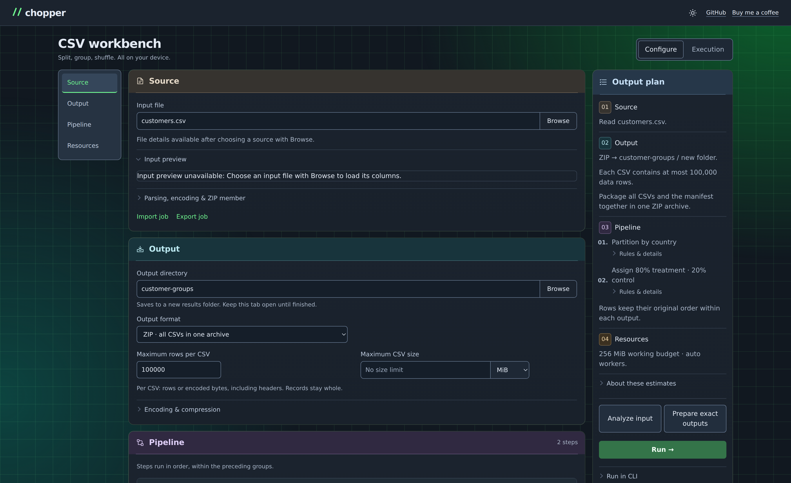

# Chopper

Chopper splits CSV files larger than memory using a native CLI for supported
64-bit Windows and Linux, or the [hosted browser app](https://chopper-1rx.pages.dev/).
Both use the Rust engine for ordered pipelines, strict validation, full random
shuffles and disk-backed processing. macOS source builds are unqualified and
not a supported release target. There is no native server or native UI.

Get CLI packages from the [releases page](https://github.com/jsmatfess/chopper/releases)
and read the [0.2.0 release notes](docs/releases/0.2.0.md) for current scope and
validation limits. This README describes current source; consult older release
notes for older package behavior.



## Build the CLI from source

Use Git, a stable Rust toolchain and a C compiler for Zstandard. Windows also
requires the Microsoft C++ Build Tools and Windows SDK. Keep vendor sources when
cloning. Native CLI builds need no Node installation and do not embed UI assets.

From the repository root:

```sh
cargo build --release --locked -p chopper
```

Run `target/release/chopper --help` on Linux or `target\release\chopper.exe --help`
in PowerShell. Optional repository-local toolchains and paired WSL/Windows
workflows are described in [Windows and WSL development](docs/windows-wsl-workflow.md).

## Try the sample

The repository includes a synthetic [12-row CSV](examples/customers.csv) and
[example job](examples/job.json). From the repository root, with `chopper` on
your PATH:

```sh
chopper run --config examples/job.json --yes
```

This partitions by country, allocates treatment/control groups, and writes
ZIP-compressed outputs and a manifest into a new `chopped-customers` directory.
Choose a new output directory in the JSON before running the example again;
Chopper protects existing destinations. You can also select the sample CSV in
the [hosted app](https://chopper-1rx.pages.dev/) to explore its columns.

## CLI examples

```sh
# Consecutive chunks, preserving input row order
chopper run --input input.csv --output results --rows 100000 --yes

# Shuffle, then split into ten balanced files
chopper run --input input.csv --output shuffled --step shuffle --step balanced --files 10 --yes

# Partition by country and allocate treatment/control
chopper run --input input.csv --output experiment --step partition --by country --step assign --groups treatment=80,control=20 --yes

# Analyze input statistics and pipeline estimates without producing output
chopper analyze --config examples/job.json
```

`run --step` preserves operation order; `split` is a convenience command with a
fixed operation order. `--yes` skips confirmation, not validation. Run prompts
before processing, prints final Analysis JSON to stdout, and sends progress and
errors to stderr. Native publication is atomic and does not replace an existing
destination. See the [Run CLI reference](docs/run-cli.md) and
[behavior specification](docs/specification.md) for the full contract.

## Build the hosted app

Hosted builds require Node.js 22+, Rust with `wasm32-wasip1`, and WASI SDK 33
for the Zstandard C codec. Follow [browser setup](docs/browser.md#local-development)
for Windows/Linux prerequisites and commands. Build the WASI engine first, then
the hosted UI; `npm run build` in `ui/` aliases the hosted build. The local
static development server is `npm run serve:hosted`. Hosted output is `ui/dist`.
The browser uses local file APIs and OPFS for input and working data, then
exports results with a completion marker; see [browser limits](docs/browser.md).

For change-specific checks, see [CONTRIBUTING.md](CONTRIBUTING.md),
[architecture](docs/architecture.md), and the [documentation guide](docs/README.md).

## Feedback and support

Chopper is independently maintained. Report bugs and suggest improvements in
[GitHub Issues](https://github.com/jsmatfess/chopper/issues); replies depend on
maintainer availability. Share a small synthetic reproduction rather than real
customer data, private paths or unredacted logs. For security concerns, use the
[private reporting instructions](SECURITY.md).

If Chopper is useful to you, you can [buy me a coffee](https://buymeacoffee.com/tblflip).
