# Execution decisions, visually

The [product direction](product-direction.md) owns the new workload-led Auto
investigation. The future design below is a prior candidate, not a settled
selector or delivery sequence. Current-behavior diagrams include the seeded-policy removal and default
shuffle/partition fusion delivered for local evaluation on 2026-11-15.

Read this as three separate decisions: how Run produces output, how execution
fits its working budget, and how a future Auto policy could choose strategies.
Solid diagrams below describe current behavior; the final diagram is explicitly
a design. The [specification](specification.md), [rewrite rules](pipeline-rewrites.md)
and [GitHub Issues](https://github.com/jsmatfess/chopper/issues) own contracts and delivery status.

## 1. Current workflow: Run, profile or prepare

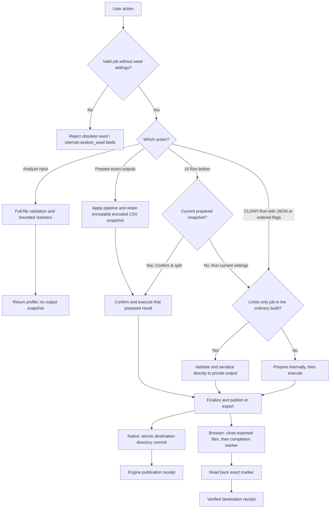

The unified `run` CLI accepts either admitted `--config` JSON or a caller-owned
Job from ordered `--step` blocks, then uses the same confirmation and
`engine::run` dispatch as `split`. Config and job-building flags cannot mix;
existing JSON memory/worker overrides remain supported.
It adds no rewrite, resource-resolution or publication policy.

Run selects its path before consuming input. Errors after direct consumption
starts terminate that attempt; they do not replay raw input. Failure/cancellation
cleans owned private output and reports cleanup failures. A profile is advisory,
not an execution snapshot. See [direct execution](direct-execution.md) and
[`engine.rs`](../crates/chopper/src/engine.rs),
[`direct.rs`](../crates/chopper/src/engine/direct.rs).

A new execution obtains internal entropy after configuration admission. No public seed
input or RNG replay requirement remains; prepared confirmation retains its snapshot.

### Native job lifecycle

The native [job module](../crates/chopper/src/server/jobs.rs) owns the lifecycle
around these engine calls. HTTP handlers decode requests and return literal
transition acknowledgements; they do not decide job-state changes.

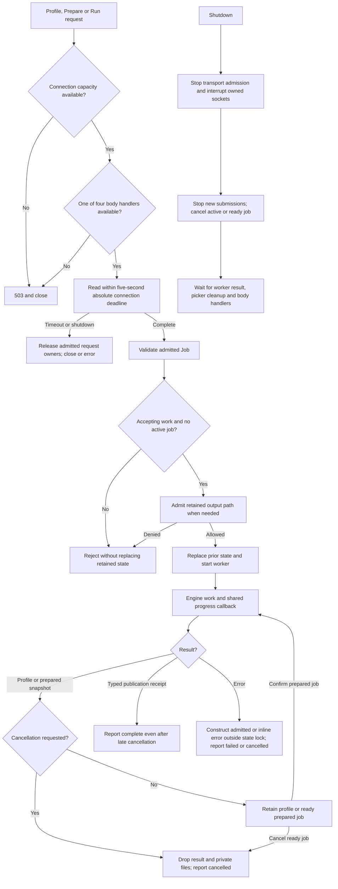

The [native HTTP contract](native-http-requests.md) defines handler, connection,
deadline and controlled-fixture response/shutdown bounds. Control routes bypass
body handlers; authentication and typed admission still precede Jobs transitions.

Cancellation of a running job requests unwinding; it does not report terminal
state before that work returns. Shutdown uses the same completion signal rather
than polling HTTP status strings. Native picker sessions keep their separate
owner. This changes lifecycle ownership, not engine Run eligibility, publication
rules or browser worker/marker behavior.

## 2. Current adaptation: budget first, admission throughout

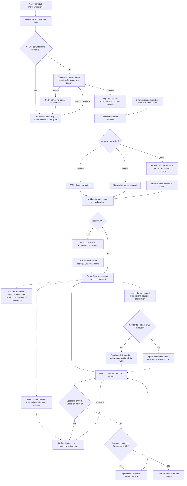

Input value shares use the same mandatory admission path, separately from optional
execution observation. Profiles and prepared analyses count values during the
existing input scan; they do not start a second pass or grow a high-cardinality
frequency table. See the [summary ownership bounds](resource-policy-research.md#selected-column-summary-admission-2026-10-23).

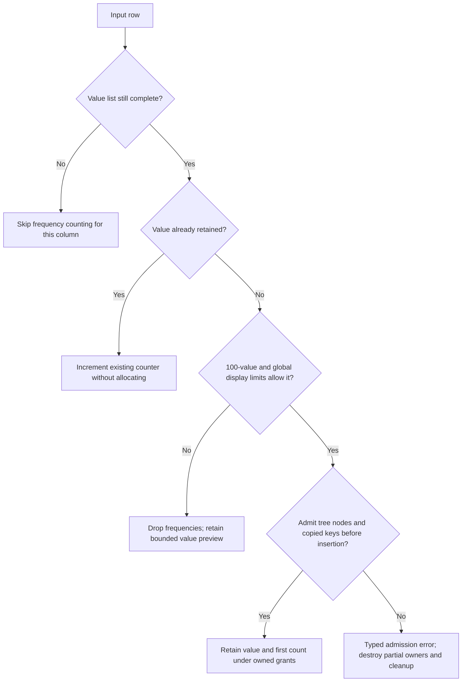

The [hosted observation contract](execution-observation.md) adds an optional
callback branch, without changing Run eligibility or mandatory allocation/retry
rules. Fixed retained producer state is inline; prepared Run has a fixed record cap and bounded operation/category/role summaries and fixed allocation/split/codec counts in the worker; serialization grants are never
held while CSV work resumes. Denial or delivery failure disables observation,
not processing. This branch is distinct from host memory-pressure discovery.

The [native scripted decoder](cli-job-decoding.md) uses only the existing shared
ledger before imported resources are known. Its source grant remains through
prompts, borrowed profile and the entire consuming Run/prepare call, intentionally
overlapping PreparedJob's independent grant. EOF does not require a speculative
next-byte grant. Metadata is not an actual-read cap. Other adapters keep their
existing construction policy; this branch does not change engine dispatch.

This is a lifetime model, not a claim that every allocation has a spill path.
The shared [CSV intake owner](../crates/chopper/src/csv_intake.rs) preserves the
existing source/parser budgets and owned/compact paths. Sorters and streaming
chains still provide their existing parser-growth admission relief; intake does
not select spill/retry policy. Profiling retains its separate Workspace and
inspection its source-buffer-only envelope and first-record scope.
Parser-owned packed rows retain their actual field capacity until the parser's
charge transfers to a row/sorter owner. They do not shrink without a row-owned
overlap grant. Decoder-owned rows may shrink only after admitting both old and
replacement capacity; denial preserves the original buffer and its charge.
Sorting can retain admitted rows in memory and use external runs/merge when
needed. At sorter creation, retained-row capacity targets the smaller of one
quarter of the numeric job budget and half the current shared admission ceiling.
This leaves room for separately admitted spill construction/I/O; observing the
ceiling grants nothing and does not change the requested/reported numeric budget.
Concurrent owners or later pressure can still deny allocations. Explicit
Fisher-Yates requires resident capacity and fails when infeasible.
Pressure checks at supported safe boundaries constrain future growth while live
owners retain their grants. Working-allocation accounting is not a complete RSS cap.

Automatic memory observes headroom; it does not reserve it. Its exact formula,
validation bounds, native worker rule and WASI single-worker restriction live in
the [resource contract](specification.md#resources-publication-and-interfaces).
See [`resources.rs`](../crates/chopper/src/resources.rs),
[`storage.rs`](../crates/chopper/src/storage.rs) and
[`storage/adaptive.rs`](../crates/chopper/src/storage/adaptive.rs).

An opt-in retained-parent rewrite has a narrower retry boundary: typed admission
denial **before emission**, after successful tentative cleanup, may retry that
parent's original stages. Cancellation, cleanup failure and errors once emission
begins are terminal. This is separate from direct Run and is not a general retry
rule. See [rewrite eligibility](pipeline-rewrites.md#current-executable-eligibility)
and [`exact_plan.rs`](../crates/chopper/src/engine/exact_plan.rs).

### Current adjacent shuffle rewrites

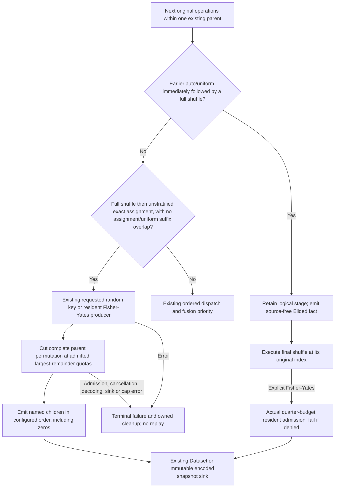

Every earlier explicit Fisher–Yates executes; neither rule crosses grouping,
assignment, positional operations or caps. Existing upstream grouping/shuffle
fusion wins before a visible pair. Both ingestion and retained execution preserve
original operation mappings and all logical stages. New range failures are
terminal, not the separate optional retained-parent retry policy above. Mixed
leading ingestion keeps parser capacity and its grants through resident handoff.
Working reservations are not an RSS cap. Adaptive ingestion and random-membership
balanced routing were evaluated but are absent from this current diagram.

## 2a. Isolated resident-allocation experiment: not production behavior

The [prepared-router patch](performance.md#resident-allocation-prepared-router-control-2026-11-02)
is retained as an unapplied experiment. Current dispatch above is unchanged.
The later [first-wide control and successor](performance.md#materialized-parent-allocation-retry-2026-11-03)
reject this prepared-router proposal as a general admission remedy.

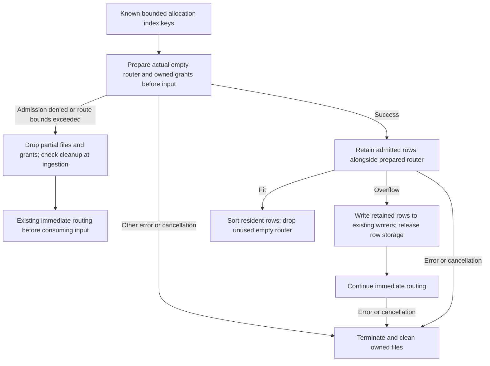

The retention ceiling is a feasibility target, not a grant. Upfront empty files,
unused keys, construction/rollback, decode and later metadata admission have costs.
The local counterexample passes; arbitrary shared-pressure success-domain inclusion
and browser execution are unproved. This does not define an Auto selector or replay
raw input after a failure. Native publication and browser marker contracts remain
separate.

## 2b. Isolated materialized-parent retry experiment

The [successor patch and bounded evidence](performance.md#materialized-parent-allocation-retry-2026-11-03)
leave root ingestion and production behavior unchanged. The retry source is an
already materialized Dataset parent, with the original membership domain.

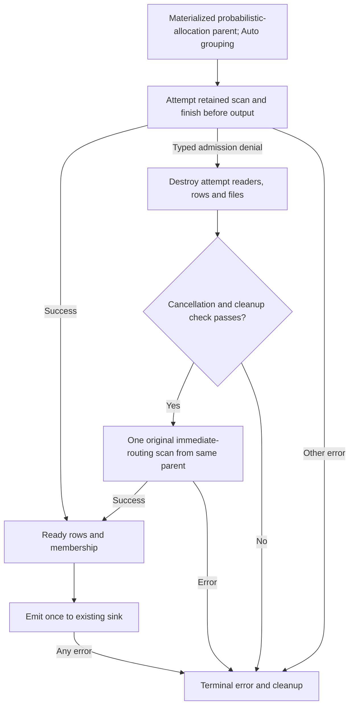

No output or raw input is replayed after emission starts. Failed attempt work is
included in execution cost. This addresses the controlled transition counterexample;
it does not prove arbitrary shared-pressure or output-metadata feasibility.
Native publication and browser completion-marker behavior retain their separate
contracts. Initial browser readiness controls used the default engine. The
[later safety/runtime evaluation](performance.md#allocation-retry-safety-and-runtime-evaluation-2026-11-03)
checks the candidate in persistent Chrome and observes native retries under a
phase-scoped shared competitor. Fitting jobs remove the temporary pass; forced
retry adds logical I/O/files with inconclusive elapsed effects. The candidate
remains unapplied; arbitrary later pressure and emission admission are unproved.

## 2c. Isolated resident child-metadata revision

The [metadata preparation control](performance.md#resident-child-metadata-preparation-control-2026-11-03)
revises the unapplied experiment only. Production dispatch is unchanged.

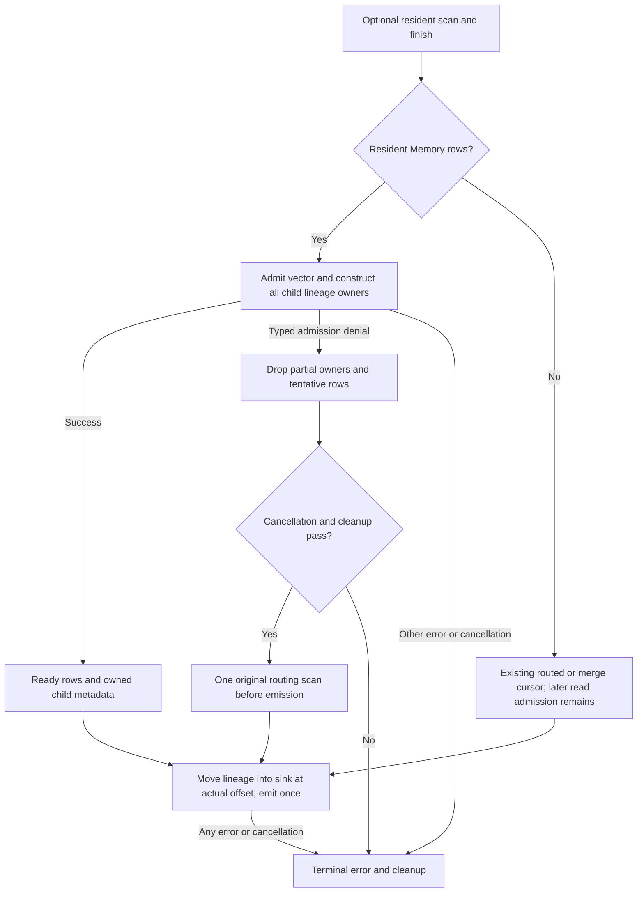

The checked boundary uses an already-live DatasetWriter and resident row-grant
transfers. Arbitrary sinks and disk read admission are outside this proof. Extra
metadata retention changes which competitors can be admitted; pre-admission does
not prove admission-domain inclusion. No emission replay, Auto promotion, native
publication change or browser completion-marker change follows.

## 2d. Isolated terminal direct Run prototype

The [native experiment](performance.md#isolated-terminal-direct-run-native-comparison-2026-11-03)
is unapplied; current production Run eligibility in diagram 1 is unchanged.

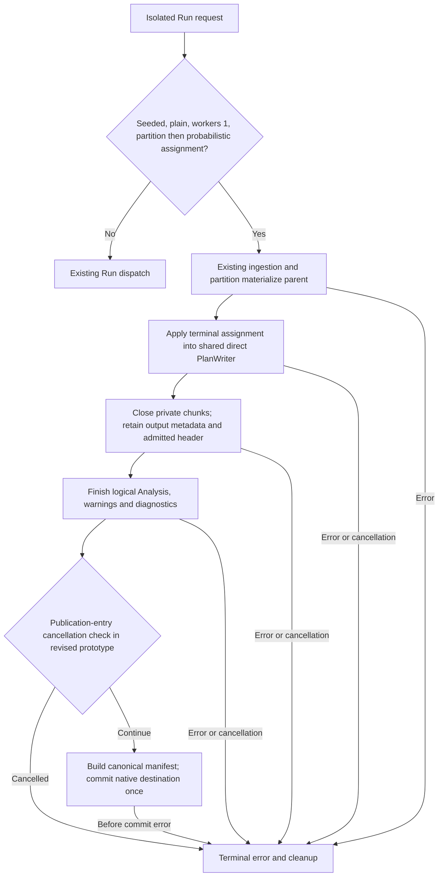

There is no consumed-input or output replay. Explicit Prepare still returns its
immutable encoded snapshot. The header clone shares its existing immutable grant.
Counter instrumentation observes logical temporary traffic after publication;
returned Analysis diagnostics still precede it. The [later Chrome/working-set controls](performance.md#terminal-direct-output-chrome-and-working-set-transfer-2026-11-03)
cover export/markers in their recorded cases. Earlier private final-file creation
changes overlap with live intermediates: charged temporary peaks do not bound
combined storage. The [storage-lifetime controls](performance.md#terminal-direct-output-storage-lifetimes-and-temp-budget-control-2026-11-03)
capture simultaneous temp/private output and a narrow 38-MiB temp-budget completion
benefit. Normal private output remains outside the charged intermediate budget;
that benefit is not a total-storage bound. Broader pipeline/codec and shared-pressure
admission feasibility remain open. A [fixed 12-MiB shared-capacity pair](performance.md#terminal-direct-output-fixed-shared-capacity-control-2026-11-03)
completes both plans with exact output, but does not cover dynamic competitors.
Existing shared-aware buffering targets are not grants or minimum required capacity.
The [dynamic-owner control](performance.md#terminal-direct-output-dynamic-owner-and-cancellation-control-2026-11-03)
adds fixed competing grants, release, final denial and cancellation. The unchanged
prototype fails cancellation precedence after its final notification; the revised
isolated publication entry checks cancellation before reserving a manifest path.
All eight revised controls pass, without proving general concurrent admission or
extending production eligibility.

## 2e. Isolated probabilistic-allocation/shuffle challenger

The [whole-plan control](performance.md#probabilistic-allocation-and-uniform-shuffle-fusion-control-2026-11-03)
is unapplied; production probabilistic allocation still materializes before shuffle.

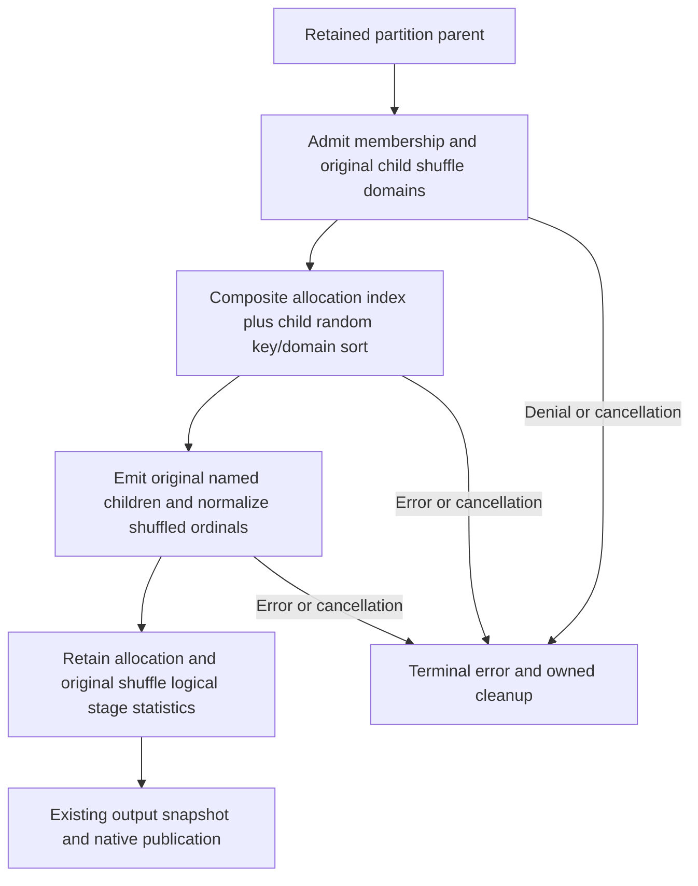

No new retry or calibrated selector is established. Larger keys/per-parent sorting
and retained domains need spill and pressure acceptance; the fitting Linux control
does not establish Windows, browser or arbitrary shared-owner feasibility.
The [fixed-capacity controls](performance.md#probabilistic-shuffle-fusion-fixed-capacity-and-external-sort-controls-2026-11-03)
complete both paths at 4 MiB and observe external sorting/merge in one larger-parent
job; the candidate adds a run and higher tracked peak despite lower logical traffic.
This preserves the broader pressure/runtime acceptance gap and adds no retry rule.
The [native semantic controls](performance.md#probabilistic-shuffle-fusion-native-semantic-and-failure-controls-2026-11-03)
cover strata/repeated shuffle indices, forced-primary tie refinement through
external sorting and public before-emission denial/cancellation on Linux/Windows.
Browser transfer and internal/late admission still remain unproved; retry is not
introduced by this acceptance record.

The [2026-11-05 production-eligibility reconciliation](performance/investigations/probabilistic-shuffle-production-eligibility-2026-11-05.md)
credits the later real prepared-writer owner, Linux/Windows external-wide,
persistent-Chrome lifecycle and scoped temporary-failure controls. The earlier
open-gap statements above describe their historical passes, not current missing
acceptance. Production remains unchanged. The following branch is a proposed
retained-parent seam, requiring separate authorization and fresh integration gates:

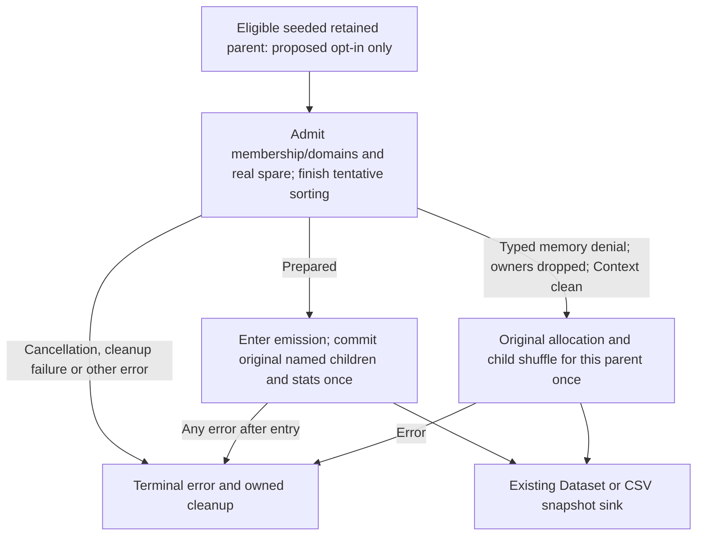

No production retry rule is added here. Earlier parents remain once; raw ingestion,
direct publication, flexible policy and default promotion are excluded. Actual
membership/sort/spill/merge/fallback facts must preserve original operation mappings
and current observation bounds; existing hosted graph acceptance is insufficient.

### Retained combined-operation output

The optional consecutive-partition, streaming-chain and partition/shuffle/balanced
callers use [retained execution](../crates/chopper/src/engine/retained_execution.rs)
for output ownership. Selection and branch-specific fallback stay in the caller.

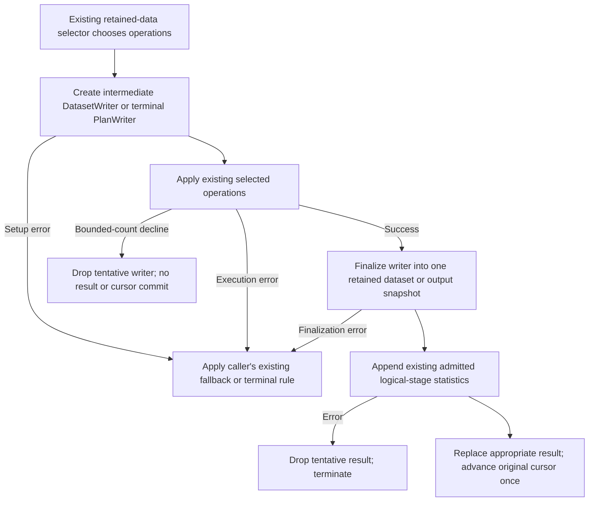

Streaming allows outer fallback only on the setup-error edge. Its retained-parent
preparation/emission rules remain in exact_plan::Proposal. Consecutive partitions
and partition/balanced preserve their own typed-denial rules; this diagram does
not broaden replay eligibility. Raw input and nested shared ranges are separate.

## 3. Future Auto strategy selection: design, not enabled

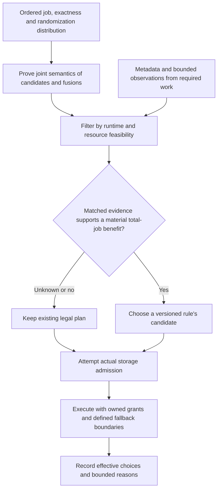

The engine will own selection for CLI, server and WASI; adapters supply runtime
capabilities. Cost includes observation, failed attempts, preparation, processing,
serialization and export. Optional new full profiling is skipped by default in
the design until measured savings justify it. Unknown width, skew, capacity or
cost favors the existing legal plan. No universal crossover is established.

Randomized output has no seeded replay policy. Auto selection and fallback may
choose different realizations of the requested distribution. Exact counts,
pipeline membership, publication and cleanup remain required. Prepared
confirmation uses its retained immutable output snapshot.

Current ordinary builds fuse adjacent automatic/uniform shuffle and column
partitioning into one tuple/random-key sort. The measured partition-first plus
independent child shuffle candidate remains rejected because of skew regressions.
A trial resident selector is also withheld after complete-job regressions.

Under the [future product direction](product-direction.md), any requested
randomization, including random allocation, removes the input-order preservation
requirement. Allocation alone does not promise uniformly shuffled output;
explicit shuffle and downstream positional semantics remain
eligibility constraints. Current allocation-order behavior is unchanged.

Future field sorting also constrains eligibility: stable multi-field text/numeric
ordering and subsequent consecutive or balanced batch membership must survive
physical rewrites. A later shuffle randomizes within those batches, not across
their boundaries. See the product direction for sorting modes and batch policies;
this does not enable new operations in the current engine.

There is no omitted-policy default or runtime policy selector. The earlier
[Auto reconciliation](adaptive-execution.md#auto-policy-reconciliation-2026-10-28)
is historical where it discusses seeded replay; the current specification owns
randomization guarantees.

## Keeping these diagrams current

Update this guide in the same change as behavior affecting Run dispatch,
resource resolution/admission, spill or retry boundaries, rewrite eligibility,
or Auto policy delivery. Check the owning contracts and linked implementation;
move a design branch into a current diagram only when implemented and validated.
Review success, denial, failure and cancellation paths, and retain native/browser
differences. Keep numerical thresholds in their owning contract rather than
copying them into every diagram.

These Mermaid sources render directly in GitHub Markdown and remain reviewable
with the code. The contributor and agent entry points route relevant changes here.
This is a review obligation, not an automatic proof that prose matches code;
contract regression tests remain the behavioral check. No scheduled refresh or
background automation is required.

## Observed external grouping/sort handoff

The #52 observation extension records the current native/WASI behavior below;
it does not add a retry or choose a new algorithm. Source identities follow the
actual run catalog, including materialized merge outputs. Unknown/suppressed
summary edges are marked omitted.

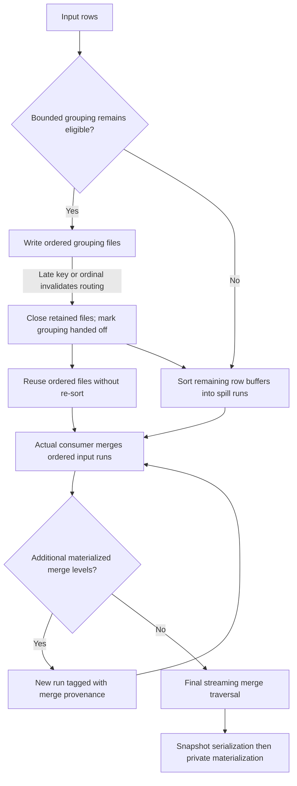

The algorithm can traverse multiple merge levels; the **displayed** graph never
uses a cycle to represent them. Repeated levels have bounded summaries with
row-visit counts and explicit omitted internal dependencies. Cancellation is an
interruption; decode/write failures retain their attributable partial visits.

## Default temporary storage

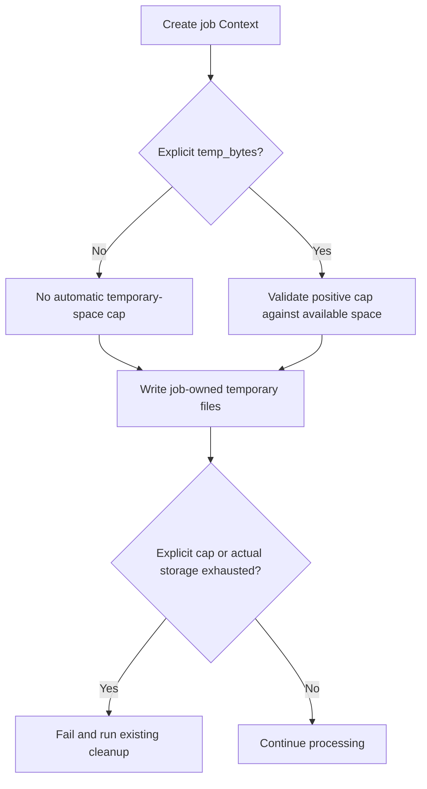

The browser no longer converts a quota estimate into a session-wide automatic
cap or reserves 20% up front. OPFS enforces actual quota, including private staged
output. Source-size estimates are advisory and do not choose execution policy.
