# Execution decisions, visually

The [product direction](maintainer/product-direction.md) owns workload-led Auto policy.
These diagrams cover Run dispatch, working-budget admission and the current
Auto planner. The [specification](specification.md), [rewrite rules](pipeline-rewrites.md)
and [GitHub Issues](https://github.com/jsmatfess/chopper/issues) own contracts and delivery status.

## 1. Current workflow: Analyze or Run

```mermaid
flowchart TD
    Request[User action] --> Schema{Valid job without seed settings?}
    Schema -->|No| RejectSeed[Reject obsolete seed / internal random_seed fields]
    Schema -->|Yes| Action{Which action?}
    Action -->|Analyze input| Profile[Full-file validation and bounded statistics]
    Profile --> Report[Return bounded observations and source binding]
    Action -->|Native Run| NativeDestination{New or empty destination with an existing parent?}
    NativeDestination -->|No| DestinationError[Reject before CSV intake or staging]
    NativeDestination -->|Yes| Witness[Record absence or retain the empty directory identity]
    Witness --> Advice[Read cheap metadata and check optional Analyze binding]
    Action -->|Hosted Run| Advice
    Report -.->|Optional| Advice
    Advice --> Calculation{Calculated column definitions?}
    Calculation -->|Yes| Calculated[Retain source snapshot, bind references and order dependencies]
    Calculated --> Boundary[Evaluate once per row before first consuming operation or during final output preparation]
    Boundary --> CalcPartition{Hosted Run or unobserved Linux Run, one Partition on a calculated field, plain output, one root group, source at least 128 MiB?}
    CalcPartition -->|Yes| CalcSort[Feed calculated rows to the existing grouping path and build the capped output snapshot]
    CalcSort -->|Success| Publish
    CalcSort -->|Retry after releasing private state| Internal
    CalcSort -->|Cancellation or cleanup failure| RouteFailed[Fail and retire owned output]
    CalcPartition -->|No| CalcDirect{Unobserved Linux Run, plain output, no ordered operations, and source at least 128 MiB?}
    CalcDirect -->|Yes| CalcPrivate[Write calculated rows to capped CSV in private publication]
    CalcPrivate --> Publish
    CalcDirect -->|No| Internal
    Calculation -->|No| Counted{Native counted Auto or opt-in, eligible UTF-8 source and Balanced shape?}
    Counted -->|Yes| CountPass[Strict count pass and direct write with decoded header, count and metadata checks]
    CountPass --> ReleaseCounted[Release first-pass metadata and any Partition proof after comparison]
    ReleaseCounted --> Publish
    Counted -->|No| Eligible{Limits-only or single plain Balanced step?}
    Eligible -->|Yes| Direct[Validate and serialize directly to private output]
    Eligible -->|No| BoundedPartition{Native bounded Partition Auto or opt-in, plain input and declared caps fit?}
    BoundedPartition -->|Yes| FanoutBuffers[Select CSV/catalog capacities; admit as owners construct]
    FanoutBuffers --> CatalogForm{Per writer: single-record experiment and exact group or no chunk caps?}
    CatalogForm -->|Yes| TypedRecord[Retain admitted name and scalars; materialize canonical root catalog in original stage at finish]
    CatalogForm -->|No| DiskRecords[Retain ordinary disk catalog]
    TypedRecord --> SyncBatch{Linux large Interleaved Auto or sync opt-in, typed records and live resources fit?}
    SyncBatch -->|Yes| SyncQueue[Select flush-all-then-sync finish; every original handle syncs before Analysis]
    SyncBatch -->|No| Direct
    SyncQueue --> Direct
    DiskRecords --> Direct
    BoundedPartition -->|No| Fanout{Native bounded final writers for eligible Interleaved, probabilistic or writer-chain work?}
    Fanout -->|Yes| FanoutBuffers
    Fanout -->|No| Chains{Native unobserved final-writer chains, 2–4 count-independent steps and leaf product within bounded memory/descriptor writer ceiling?}
    Chains -->|Yes| FanoutBuffers
    Chains -->|No| Experiment{Eligible Linux Auto terminal Uniform or opt-in terminal shuffle?}
    Experiment -->|Yes| TailMerge{Linux short-tail eligibility with admitted pending and reader budgets?}
    TailMerge -->|Admitted| ShortTail[Retain bounded pending owners and consolidate only excess runs before final merge]
    TailMerge -->|Otherwise or limit reached| Direct
    ShortTail --> Direct
    Experiment -->|No| Routing{Native retained exact Auto or terminal-routing opt-in?}
    Routing -->|Yes| ExactWriters{Singleton stratified exact with bounded configured writers and live headroom?}
    ExactWriters -->|Yes| ExactSetup[Keep original empty writer witness; count retained tuples, quotas and RNG states; admit final writers]
    ExactSetup --> ExactReady{Preparation admitted and no cancellation or cleanup fault?}
    ExactReady -->|Yes| ExactEmit[Traverse same parent in source order; emit original quota streams; all later errors terminal]
    ExactEmit --> Publish
    ExactReady -->|Typed memory denial only| OriginalExact[Drop tentative owners; use same immutable parent and original writer]
    OriginalExact --> Direct
    ExactReady -->|Other error| ExactFail[Fail and clean private output]
    ExactWriters -->|No| Direct
    Routing -->|No| Internal[Prepare snapshot internally, then execute]
    Direct --> Publish[Finalize and publish or export]
    Internal --> Publish
    Publish --> Native{Linux or Windows Run at snapshot publication, one plain Partition, at least 2 GiB and 1,152 files, and four workers?}
    Native -->|Yes| NativeBatch[Choose up to four writers per batch using live memory, descriptors and remaining files]
    Native -->|Other native publication| NativeCommit[Recheck the empty directory identity before removal and rename without replacement]
    NativeBatch --> NativeCommit --> NativeReceipt[Engine publication receipt]
    NativeCommit -->|Commit failure| NativeCleanup[Clean owned staging and temporary files]
    Publish --> Browser[Browser destination publication]
    Browser --> Format{ZIP?}
    Format -->|No| StreamIO{Selected CSV with plain output and supported pipeline?}
    StreamIO -->|Empty pipeline with plain CSV input/output| Overlap[Prefetch one source window and coalesce one destination block]
    StreamIO -->|One Partition with plain CSV input/output| SourceAhead[Prefetch one source window]
    StreamIO -->|Other direct output| DirectFile[Write final files to the selected destination during engine publication]
    Overlap --> DirectFile
    SourceAhead --> DirectFile
    Format -->|Yes| StagedFile[Copy closed OPFS results to the selected destination]
    DirectFile --> Marker[Drain pending writes, close all destination streams and write completion marker]
    StagedFile --> Marker
    Marker --> VerifyMarker{Read back exact marker}
    VerifyMarker -->|Exact match| BrowserReceipt[Verified destination receipt]
    VerifyMarker -->|Confirmed invalid or missing| BrowserCleanup[Attempt cleanup of job-owned incomplete output]
    VerifyMarker -->|Closed marker unreadable| BrowserRetain[Preserve destination and report verification failure]
```

The unified `run` CLI accepts either admitted `--config` JSON or a caller-owned
Job from ordered `--step` blocks, then uses the same confirmation and
`engine::run` dispatch as `split`. Config and job-building flags cannot mix;
existing JSON memory/worker overrides remain supported.
Native publication checks the path again before creating staging. A directory
that appears after an absent preflight is refused, even if it is empty. A
permitted empty destination must have the preflight identity at staging and at
the final check before non-recursive removal. The
[native publication contract](direct-execution.md) describes the race between
the identity check and removal.
[Native Auto paths](direct-execution.md#native-auto-paths) lists the measured
route bounds. Native direct dispatch checks live working headroom after building
the context. It may return to the ordinary plan before opening the destination.
Linux checks the actual rounded quota vector before selecting the in-place
exact allocation cursor.

Run also returns an Auto report alongside its existing diagnostics. It is attached
after successful engine publication and is separate from the manifest snapshot.
It counts a retained-exact preparation denial when the engine retries with
ordinary exact allocation.

### Run route prerequisites

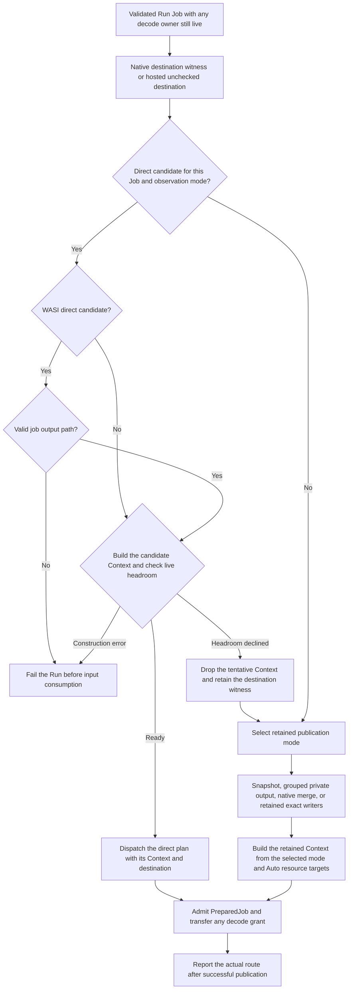

Explicit preparation builds a snapshot Context without selecting a Run route.
Native preflight includes the live decode charge when sizing Auto or checking
route headroom. Saved native and hosted Run both transfer that charge after
Context creation. See the [saved Job ownership contract](cli-job-decoding.md#saved-job-run).
Retained-parent retries and publication errors remain governed by the selected
execution path. The [direct-output route inventory](performance/investigations/hosted-partition-shuffle-direct-output-2026-11-26.md#current-routes)
also traces the independent hosted CSV/gzip and ZIP export routes.

#### Hosted Partition and shuffle output choice

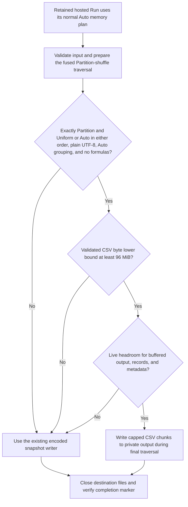

The buffer and headroom rules sit with the [direct execution contracts](direct-execution.md).
The choice uses the current intake and leaves Analyze's advisory role unchanged.

### Engine output staging

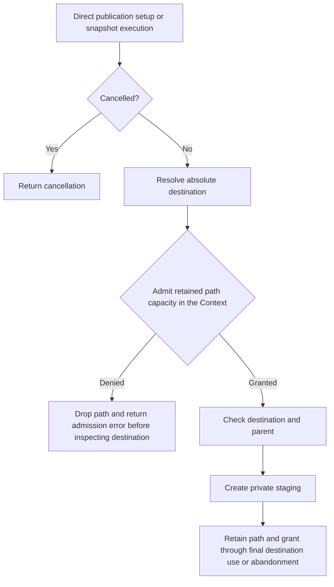

### Current gzip and ZIP compression

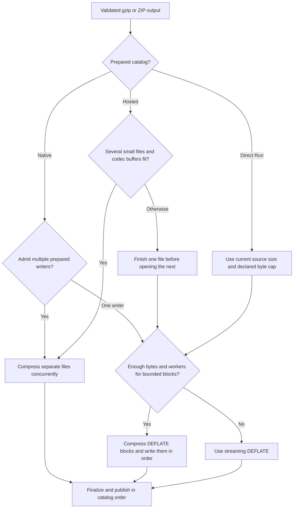

The [codec contract](specification.md#compression-and-archives) owns CSV and ZIP
semantics. [Direct execution](direct-execution.md#compression-selection) describes
the eligibility, owner bounds, and ZIP scratch paths.

The terminal-shuffle experiment retains root Uniform/Auto–Balanced eligibility.
Its native unobserved extension permits a standalone full Shuffle or root
Uniform/Auto–Partition; physical/snapshot observation and WASI keep their prior
eligibility. Bounded final-writer chains admit all configured parent membership
state and writer metadata, preserve original domains/counters, and retain the
first private publication's destination witness through canonical renaming and
commit. Prefixes/file buffers remain per writer; shared encoded row scratch has
its own opt-in control. See [direct execution](direct-execution.md).

Within native terminal Uniform execution, the Linux short-tail experiment
admits its pending catalog and uses the existing memory-derived reader bound,
with a ceiling of 512. Low descriptor limits and tighter catalog, reader,
temporary-space or pending-file bounds retain or restore ordinary hierarchical
merging. Fallback transfers the admitted run owners before another merge reads
them, preserving ownership, cleanup and final order.

The configured writer ceiling is at most 16 unless the native opt-in
`experimental-memory-final-writers` feature is enabled. That experiment uses
`min(4096, memory_mb * 4)`, conservatively substituting 32 MiB for unresolved
`auto`; Unix additionally limits two descriptors per writer after leaving 64
from the soft `RLIMIT_NOFILE` ceiling. The ordinary fixed ceiling also respects
the descriptor guard. Auto uses a conservative ceiling of 16 when native
descriptor availability is unknown. Non-Unix builds of the opt-in writer
use the memory-derived limit. This pre-consumption selection bound grants
no memory or handles. All owners still admit capacity; wide headers, concurrent
pressure and opens can fail terminally. Larger fanouts retain the existing path.
With `experimental-small-final-buffers`, configured fanout alone uses 16 KiB
plain buffers and the ceiling becomes `min(8192, memory_mb * 8)`, retaining the
same automatic-budget substitution and descriptor guard. Other output buffers
keep their original sizes; both controls remain opt-in.
The independent `experimental-small-final-catalogs` control selects 512-byte
metadata buffers when constructing these bounded fanout writers, admitting that
capacity before allocation. It changes neither the writer ceiling nor CSV buffers;
default, snapshot and other direct-publication catalogs retain 8 KiB buffers.

The independent `experimental-single-final-catalog` control replaces each
proved-one-chunk fanout catalog with one typed record owning its existing admitted
name; exact groups or absence of every chunk cap prove that condition. Selection
keeps the existing writer ceiling and conservative two-descriptor guard. At
canonical merge, the first group materializes one root catalog inside its original
stage and destination witness; other typed records append directly. Multi-chunk
and other constructors retain disk catalogs. Serialized metadata limits, source
validation and terminal cleanup remain required; Analyze advice is not consumed.

With the separate `experimental-single-catalog-capacity` control, jobs without
any chunk cap use `min(16384, memory_mb * 16)` and one descriptor per writer in
the Unix soft-limit guard, leaving the same 64-handle margin. It requires the
single-record catalog and 16 KiB CSV-buffer controls. Auto still substitutes
32 MiB; cap-bearing jobs keep previous ceilings and two-descriptor accounting.
Every memory/file owner retains independent admission, with terminal cleanup.
This is a bounded selection extension, not an unbounded writer pool.

The Linux-only `experimental-batched-final-sync` control changes scheduling for
unobserved plain typed catalogs. Each close flushes/releases its buffer and retains
the original File. Canonical merge admits and transfers those handles to the root;
once all writers have flushed, every handle is synchronized/drained before Analysis
construction. Publication repeats an empty guard before the manifest and commit.
No sync, original stage/witness or error/cancellation cleanup is removed. Windows,
WASI, observed, codec and multi-chunk paths keep prior scheduling.

The bounded-final-partition control uses the existing physical `max_files`
ceiling as a bound on successful distinct groups. It never treats an Analyze
estimate as proof. An admitted tuple map discovers groups and finalizes them in
original canonical key order; a seed private publication preserves the destination
witness, including empty output. File-limit/admission/parser errors are terminal,
without post-emission fallback. Unsupported shapes keep existing selection before
input consumption. Analyze's optional numeric writer advice uses existing input
statistics and static fanouts, keeps unsupported correlated shapes unknown, and
is recomputed after cache reuse. It is not an executable snapshot or Run lease.

Counted Partition followed by Balanced has its own native experimental flag.
It requires plain UTF-8 input, plain output, Auto grouping and a configured
file ceiling within the writer capacity. The count pass retains bounded tuple
counts and a logical digest. The write pass uses exact per-key remainder quotas
and canonical publication order, and compares its digest with the first pass.

Counted Balanced accepts plain UTF-8 source and validates it on both passes.
Output is plain unless `experimental-counted-codec-balanced` enables the gzip
and ZIP direct adapters. Singleton Balanced compares the decoded
header, row count, source length and modification time before publication.
An edit that preserves all four can go undetected. Analysis and the manifest
use the digest of the emitted rows. Exact quotas and error cleanup still apply.
The separate header-scratch
release control drops unused per-writer encoder buffers
before returning their grants; encoded prefixes remain owned. These controls do
not change default or WASI selection.

Run selects its path before consuming input. Errors after direct consumption
starts terminate that attempt; they do not replay raw input. Failure/cancellation
cleans owned private output and reports cleanup failures. A profile is advisory,
not an execution snapshot. See [direct execution](direct-execution.md) and
[`engine.rs`](../crates/chopper/src/engine.rs),
[`direct.rs`](../crates/chopper/src/engine/direct.rs).

A new execution obtains internal entropy after configuration admission. No public seed
input or RNG replay requirement remains; internal snapshot execution retains its bytes.
Analyze never retains an executable result or authorizes publication.

### Historical native server job lifecycle

The retired native server's job module owned the lifecycle around these engine
calls. HTTP handlers decoded requests and returned transition acknowledgements.
The job module decided state changes.

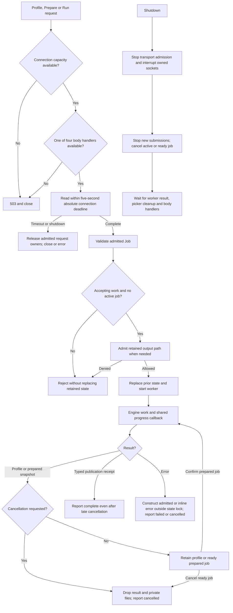

The [native HTTP contract](maintainer/research/native-http-requests.md) defines handler, connection,
deadline and controlled-fixture response/shutdown bounds. Control routes bypass
body handlers; authentication and typed admission still precede Jobs transitions.

Cancellation of a running job requests unwinding; it does not report terminal
state before that work returns. Shutdown uses the same completion signal rather
than polling HTTP status strings. Native picker sessions keep their separate
owner. This changes lifecycle ownership, not engine Run eligibility, publication
rules or browser worker/marker behavior.

## 2. Current adaptation: budget first, admission throughout

```mermaid
flowchart TD
    Scripted[Native scripted Analyze/Run] --> Metadata[Metadata size check then open]
    Metadata --> Defaults{Shared defaults grant available?}
    HostedJob[Hosted Job] --> HostedOpen[Open virtual file and admit defaults plus 8 KiB buffer]
    HostedOpen --> Decode
    HostedOpen -->|Denied| DecodeError
    Defaults -->|No| DecodeError[Admission error; drop partial payload before grant]
    Defaults -->|Yes| Decode[Direct typed reader; admit lexical prefix before byte delivery]
    Decode -->|Denied| Sticky[Sticky denial; no further source reads]
    Sticky --> DecodeError
    Decode -->|JSON or I/O error| DecodeError
    Decode -->|Success| Source[Drop parser; shrink to immutable retained Job capacity]
    Source --> Config[Resolve requested resources]
    Other[Other existing admitted or caller-owned adapters] --> Config
    Config --> Memory{memory_mb setting?}
    Memory -->|Omitted| Observe
    Memory -->|Integer| Numeric[Use explicit numeric budget]
    Memory -->|auto| Observe[Refresh pressure; observe shared admission headroom]
    Observe --> Target[Hosted Run: eligible shuffle uses file size, matching preview, bounded interior widths or gzip trailer, and matching Analyze]
    Target --> Resolve[Resolve Run target and fallback tier; credit only this same-pool hosted Job for sizing]
    Observe --> LinuxTarget[Linux shuffle: matching Analyze can target 384 MiB to avoid an extra merge]
    LinuxTarget --> Resolve
    Numeric --> Validate[Validate budget, record limit and workers]
    Resolve --> Validate
    Validate --> Hosted{Hosted WASI?}
    Hosted -->|Yes| BrowserLimit[At most 2048 MiB requested; one worker]
    BrowserLimit --> BrowserPool[1 GiB shared tracked ledger; 2 GiB linear ceiling]
    BrowserPool --> Context[Create Context; prepared execution reuses it]
    Hosted -->|No| Context
    Context --> Next[Next bounded allocation or growth]
    Context -->|Hosted Run preparation| Transfer[Verify pool identity, admit full local capacity and only the shared seed delta]
    Transfer -->|Success| Work
    Transfer -->|Denial; roll back tentative local charge| Error
    Context -.-> Observation[Hosted direct/prepared Run: optional bounded observation]
    Observation --> ObservationGrant{8192-byte callback grant available?}
    ObservationGrant -->|Yes| Snapshot[Emit bounded snapshot; release grant before CSV work]
    ObservationGrant -->|No| Disable[Report unavailable; disable observation; continue CSV]
    Snapshot -.-> Next
    Disable -.-> Next
    Context -.-> SortTarget[Sorters bound retained rows by job and shared ceilings]
    SortTarget -.-> Work
    Next --> Pressure{Pressure refresh due?}
    Pressure -->|No| Admit{Local and shared admission allow it?}
    Pressure -->|Yes| Cache{Linux cache-headroom experiment enabled?}
    Cache -->|No| Raw[Existing platform headroom and fallback]
    Cache -->|Yes| Usable{Complete hierarchy; usable own-cache and zero-protection data?}
    Usable -->|No| Raw
    Usable -->|Yes| Estimate[Estimate own clean inactive-file credit below ancestor maxima; retain raw high boundary]
    Estimate --> Ceiling[Retain startup ceiling and half-headroom growth margin]
    Raw --> Ceiling
    Ceiling --> Admit
    Admit -->|Yes| Work[Perform bounded work under owned grants]
    Work -->|More work| Next
    Admit -->|No| Fallback{Supported bounded fallback available?}
    Fallback -->|Yes| Spill[Spill or use the path's defined fallback]
    Spill --> Next
    Fallback -->|No| Error[Clear resource error and cleanup]
```

Input value shares use the same mandatory admission path, separately from optional
execution observation. Profiles and prepared analyses count values during the
existing input scan; they do not start a second pass or grow a high-cardinality
frequency table. See the [summary ownership bounds](resource-policy-research.md#selected-column-summary-admission-2026-10-23).

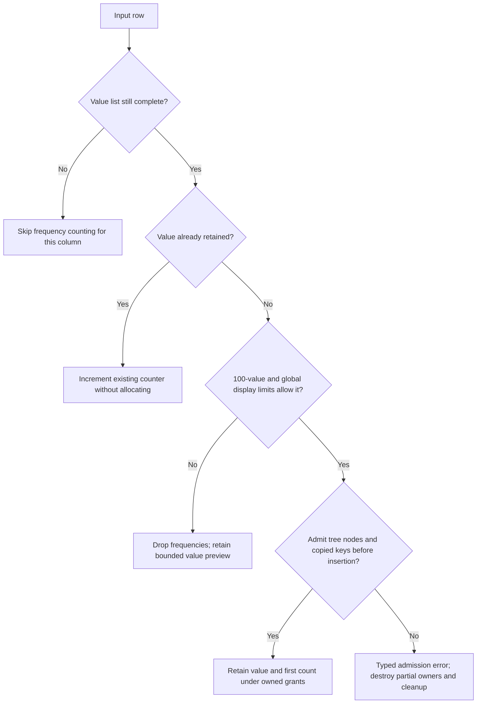

The [hosted observation contract](execution-observation.md) adds an optional
callback branch, without changing Run eligibility or mandatory allocation/retry
rules. Fixed retained producer state is inline; prepared Run has a fixed record cap and bounded operation/category/role summaries and fixed allocation/split/codec counts in the worker; serialization grants are never
held while CSV work resumes. Denial or delivery failure disables observation,
not processing. This branch is distinct from host memory-pressure discovery.

The [native scripted decoder](cli-job-decoding.md) uses only the existing shared
ledger before imported resources are known. Its source grant remains through
prompts and the entire consuming Run/Analyze call, intentionally
overlapping PreparedJob's independent grant. EOF does not require a speculative
next-byte grant. Metadata is not an actual-read cap. Other adapters keep their
existing construction policy; this branch does not change engine dispatch.

This is a lifetime model, not a claim that every allocation has a spill path.
The shared [CSV intake owner](../crates/chopper/src/csv_intake.rs) preserves the
existing source/parser budgets and owned/compact paths. Sorters and streaming
chains still provide their existing parser-growth admission relief; intake does
not select spill/retry policy. Profiling retains its separate Workspace and
inspection its source-buffer-only envelope and first-record scope.
Parser-owned packed rows retain their actual field capacity until the parser's
charge transfers to a row/sorter owner. They do not shrink without a row-owned
overlap grant. Decoder-owned rows may shrink only after admitting both old and
replacement capacity; denial preserves the original buffer and its charge.
Sorting can retain admitted rows in memory and use external runs/merge when
needed. At sorter creation, retained-row capacity targets the smaller of one
quarter of the numeric job budget and half the current shared admission ceiling.
This leaves room for separately admitted spill construction/I/O; observing the
ceiling grants nothing and does not change the requested/reported numeric budget.
At the leading hosted Uniform sort, the explicit 1024 MiB Run guard
can select 320 MiB with at least 448 MiB of available working capacity.
It returns to the ordinary ceiling after the first spill.
Concurrent owners or later pressure can still deny allocations. Explicit
Fisher-Yates requires resident capacity and fails when infeasible.
Pressure checks at supported safe boundaries constrain future growth while live
owners retain their grants. Working-allocation accounting is not a complete RSS cap.

Automatic memory observes headroom; it does not reserve it. Its exact formula,
validation bounds, native worker rule and WASI single-worker restriction live in
the [resource contract](specification.md#resources-publication-and-interfaces).
See [`resources.rs`](../crates/chopper/src/resources.rs),
[`storage.rs`](../crates/chopper/src/storage.rs) and
[`storage/adaptive.rs`](../crates/chopper/src/storage/adaptive.rs).

An opt-in retained-parent rewrite has a narrower retry boundary: typed admission
denial **before emission**, after successful tentative cleanup, may retry that
parent's original stages. Cancellation, cleanup failure and errors once emission
begins are terminal. This is separate from direct Run and is not a general retry
rule. See [rewrite eligibility](pipeline-rewrites.md#current-executable-eligibility)
and [`exact_plan.rs`](../crates/chopper/src/engine/exact_plan.rs).

### Current shared Balanced checkpoints

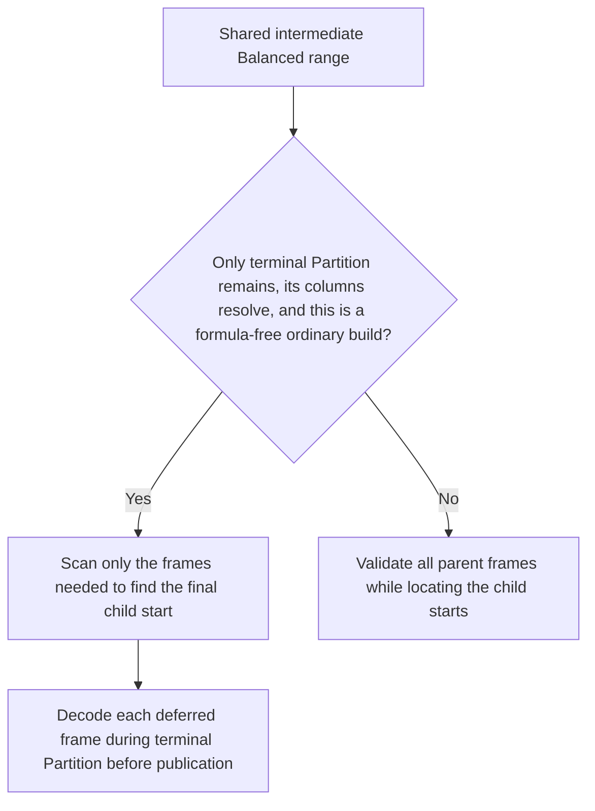

Balanced(1) can reuse the recorded parent start without opening a scan reader.
Balanced observation reports actual frame visits and the existing child sizes.
The terminal Partition retains its normal decoding, cap checks, and publication
boundary. Invalid selectors, calculated pipelines, and the experimental constant
Partition build retain the full scan.

### Current probabilistic allocation lookup

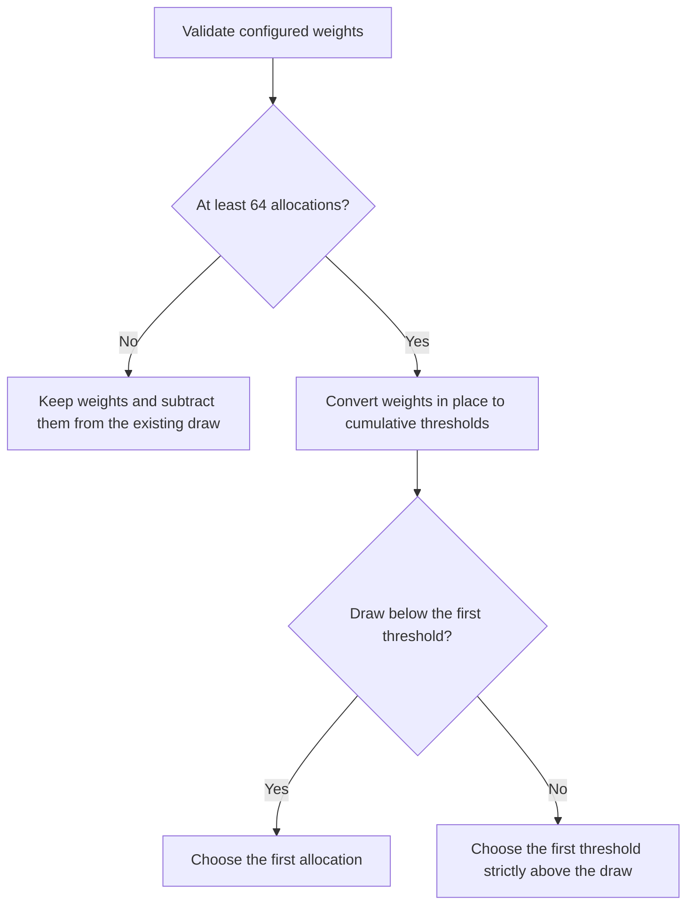

Zero weights remain empty. Both lookups use the same stratified row draw and
configured group order. Cumulative thresholds reuse the admitted weight vector.

### Current adjacent shuffle rewrites

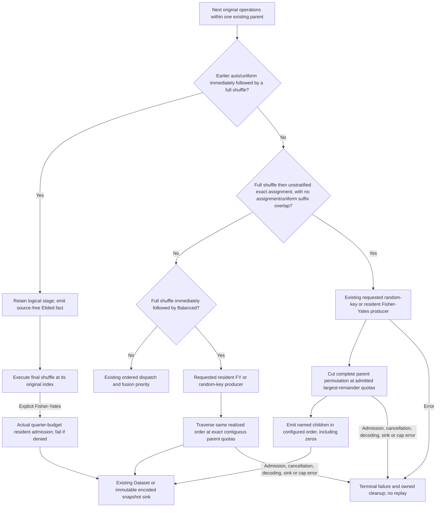

Every earlier explicit Fisher–Yates executes; these rules do not cross grouping,
assignment, positional operations or caps. Existing upstream grouping/shuffle
fusion wins before a visible pair. Both ingestion and retained execution preserve
original operation mappings and all logical stages. New range failures are
terminal, not the separate optional retained-parent retry policy above. Mixed
leading ingestion keeps parser capacity and its grants through resident handoff.
Working reservations are not an RSS cap. Adaptive ingestion and random-membership
balanced routing were evaluated but are absent from this current diagram.

## 2a. Isolated resident-allocation experiment: not production behavior

The [prepared-router patch](performance.md#resident-allocation-prepared-router-control-2026-11-02)
is retained as an unapplied experiment. Current dispatch above is unchanged.
The later [first-wide control and successor](performance.md#materialized-parent-allocation-retry-2026-11-03)
reject this prepared-router proposal as a general admission remedy.

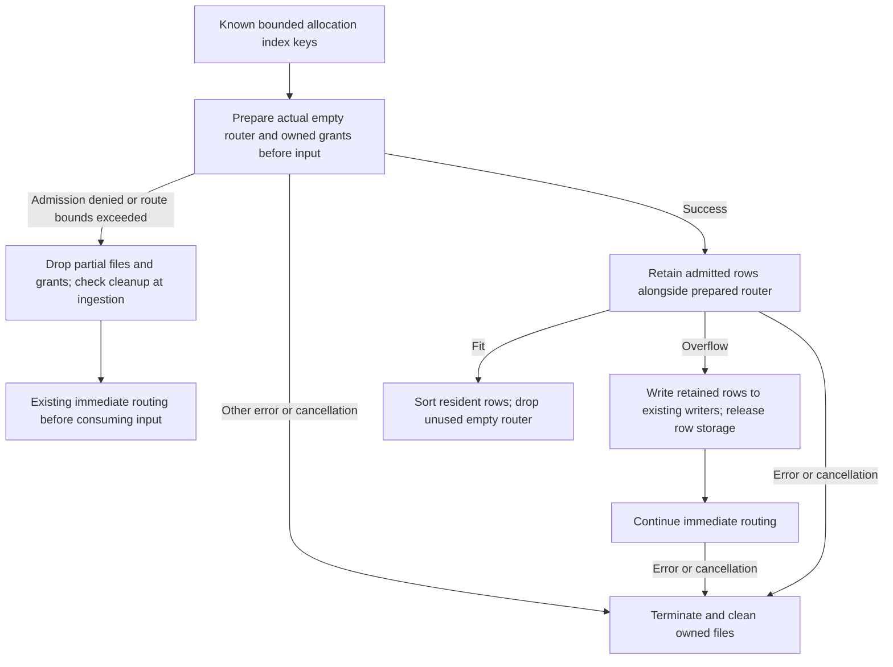

The retention ceiling is a feasibility target, not a grant. Upfront empty files,
unused keys, construction/rollback, decode and later metadata admission have costs.
The local counterexample passes; arbitrary shared-pressure success-domain inclusion
and browser execution are unproved. This does not define an Auto selector or replay
raw input after a failure. Native publication and browser marker contracts remain
separate.

## 2b. Isolated materialized-parent retry experiment

The [successor patch and bounded evidence](performance.md#materialized-parent-allocation-retry-2026-11-03)
leave root ingestion and production behavior unchanged. The retry source is an
already materialized Dataset parent, with the original membership domain.

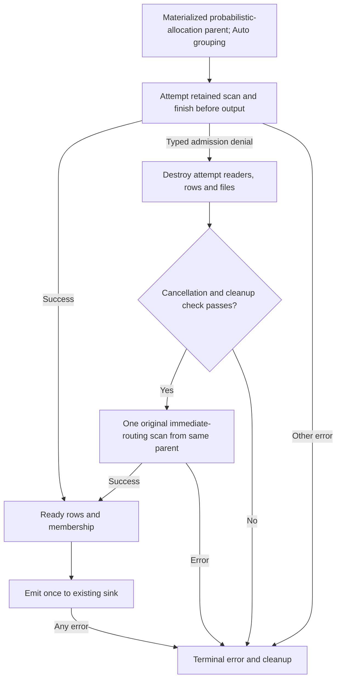

No output or raw input is replayed after emission starts. Failed attempt work is
included in execution cost. This addresses the controlled transition counterexample;
it does not prove arbitrary shared-pressure or output-metadata feasibility.
Native publication and browser completion-marker behavior retain their separate
contracts. Initial browser readiness controls used the default engine. The
[later safety/runtime evaluation](performance.md#allocation-retry-safety-and-runtime-evaluation-2026-11-03)
checks the candidate in persistent Chrome and observes native retries under a
phase-scoped shared competitor. Fitting jobs remove the temporary pass; forced
retry adds logical I/O/files with inconclusive elapsed effects. The candidate
remains unapplied; arbitrary later pressure and emission admission are unproved.

## 2c. Isolated resident child-metadata revision

The [metadata preparation control](performance.md#resident-child-metadata-preparation-control-2026-11-03)
revises the unapplied experiment only. Production dispatch is unchanged.

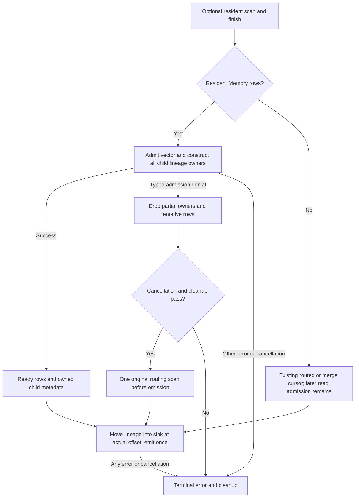

The checked boundary uses an already-live DatasetWriter and resident row-grant
transfers. Arbitrary sinks and disk read admission are outside this proof. Extra
metadata retention changes which competitors can be admitted; pre-admission does
not prove admission-domain inclusion. No emission replay, Auto promotion, native
publication change or browser completion-marker change follows.

## 2d. Isolated terminal direct Run prototype

The [native experiment](performance.md#isolated-terminal-direct-run-native-comparison-2026-11-03)
is unapplied; current production Run eligibility in diagram 1 is unchanged.

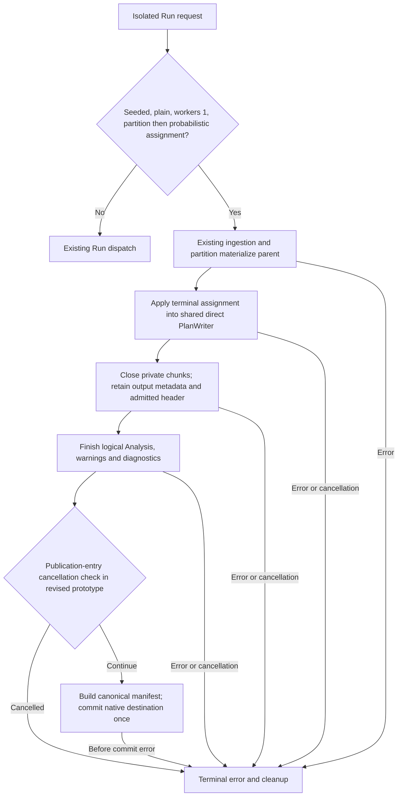

There is no consumed-input or output replay. Explicit Prepare still returns its
immutable encoded snapshot. The header clone shares its existing immutable grant.
Counter instrumentation observes logical temporary traffic after publication;
returned Analysis diagnostics still precede it. The [later Chrome/working-set controls](performance.md#terminal-direct-output-chrome-and-working-set-transfer-2026-11-03)
cover export/markers in their recorded cases. Earlier private final-file creation
changes overlap with live intermediates: charged temporary peaks do not bound
combined storage. The [storage-lifetime controls](performance.md#terminal-direct-output-storage-lifetimes-and-temp-budget-control-2026-11-03)
capture simultaneous temp/private output and a narrow 38-MiB temp-budget completion
benefit. Normal private output remains outside the charged intermediate budget;
that benefit is not a total-storage bound. Broader pipeline/codec and shared-pressure
admission feasibility remain open. A [fixed 12-MiB shared-capacity pair](performance.md#terminal-direct-output-fixed-shared-capacity-control-2026-11-03)
completes both plans with exact output, but does not cover dynamic competitors.
Existing shared-aware buffering targets are not grants or minimum required capacity.
The [dynamic-owner control](performance.md#terminal-direct-output-dynamic-owner-and-cancellation-control-2026-11-03)
adds fixed competing grants, release, final denial and cancellation. The unchanged
prototype fails cancellation precedence after its final notification; the revised
isolated publication entry checks cancellation before reserving a manifest path.
All eight revised controls pass, without proving general concurrent admission or
extending production eligibility.

## 2e. Linux opt-in probabilistic assignment and Uniform fusion

The opt-in feature `experimental-probabilistic-shuffle-fusion` applies to plain
Partition → probabilistic assignment → explicit Uniform. It shares the existing
immutable snapshot publication. The sorter admits a real 64 KiB spill file and
writer before it accumulates rows. Membership keeps the original assignment
domain and each named child keeps its original shuffle domain.

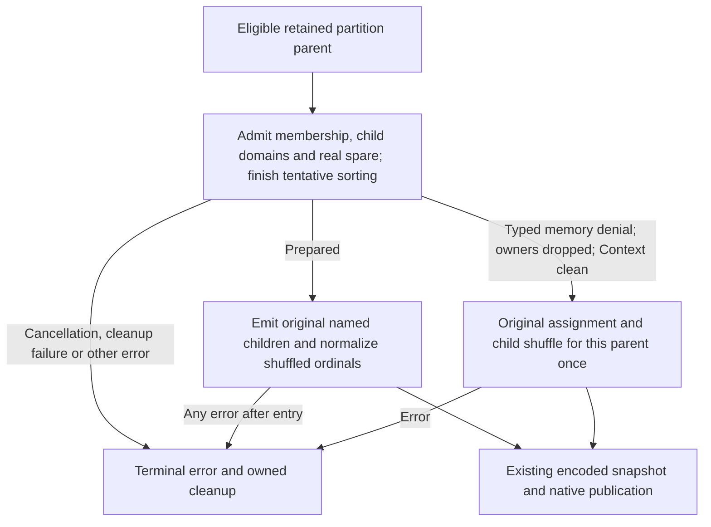

Each parent commits once. The committed result supplies original assignment and
shuffle stage counts. Observation uses the original operation indices for
membership, sorting, spill and traversal. Baseline Run workflows use the original
assignment stage before the shuffle. The [matched Linux controls and timing](performance/investigations/probabilistic-shuffle-fusion-at-2-gib-2026-11-21.md)
and [earlier prototype coverage](performance/investigations/probabilistic-shuffle-production-eligibility-2026-11-05.md)
describe each validated scope.

### Retained combined-operation output

The optional consecutive-partition, streaming-chain and partition/shuffle/balanced
callers use [retained execution](../crates/chopper/src/engine/retained_execution.rs)
for output ownership. Selection and branch-specific fallback stay in the caller.

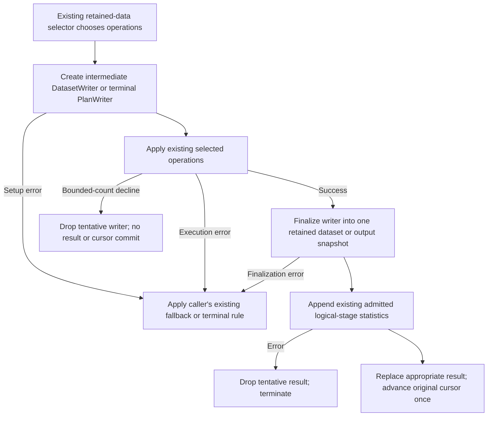

Streaming allows outer fallback only on the setup-error edge. Its retained-parent
preparation/emission rules remain in exact_plan::Proposal. Consecutive partitions
and partition/balanced preserve their own typed-denial rules; this diagram does
not broaden replay eligibility. Raw input and nested shared ranges are separate.

## 3. Current Auto planning

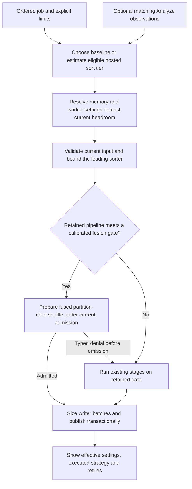

User-facing jobs default to automatic working memory. Explicit budgets and worker
counts take precedence. Native serial routes with automatic workers use one.
A prepared native Run with matching Analyze facts at or below 10,000 rows and
1 MiB decoded payload also uses one automatic worker. Other native jobs reuse
the CPU and memory worker ceiling. WASI uses a single processing worker.
For plain-output uniform shuffle and Partition → Uniform Shuffle with automatic
grouping, hosted Run estimates sort footprint and can target 512, 1024, or 2048
MiB. It starts with plain CSV file size and pipeline shape, and uses matching
Analyze row and width facts when available. Insufficient free capacity returns
to the baseline Auto budget before processing. Actual allocation admission and
the normal external sort fallback still apply.
[Hosted memory evidence](performance/investigations/browser-auto-memory-tiers-2026-11-21.md).

Prepared Run sizes concurrent publication batches on the routes that support
them using remaining chunks, workspace and shared memory headroom, worker count
and descriptor headroom. Plain output and WASI use serial publication by default.
Actual allocations and opens still require admission.

The shipped WASI fusion gate accepts plain-output Partition → Probabilistic
Assign → Uniform or Auto shuffle with Auto grouping, 2–8 validated root groups,
at least 40,000 validated records, at least 4 MiB decoded payload, and a 32 or
256 MiB budget. The narrow Linux gate uses four groups, one worker, a 128 MiB
budget, at least 8 million records and 1,900 MiB decoded payload, and an estimated
largest parent payload of at least 256 MiB. The Linux estimate filters candidates
using the validated largest group count and average payload. Actual allocation
always uses the existing shared and local admission checks.

Typed pre-emission memory denial falls back on the same retained parent.
Cancellation, cleanup failures and errors after emission stay terminal.
The experimental index, terminal direct variants and archived resident buckets
are outside automatic selection. See the [Chromium calibration](performance/investigations/auto-chromium-thresholds-and-resource-calibration-2026-11-21.md)
and [Linux fusion evidence](performance/investigations/probabilistic-shuffle-fusion-at-2-gib-2026-11-21.md).

## Keeping these diagrams current

Update this guide in the same change as behavior affecting Run dispatch,
resource resolution/admission, spill or retry boundaries, rewrite eligibility,
or Auto policy delivery. Check the owning contracts and linked implementation;
move a design branch into a current diagram only when implemented and validated.
Review success, denial, failure and cancellation paths, and retain native/browser
differences. Keep numerical thresholds in their owning contract rather than
copying them into every diagram.

These Mermaid sources render directly in GitHub Markdown and remain reviewable
with the code. The contributor and agent entry points route relevant changes here.
This is a review obligation, not an automatic proof that prose matches code;
contract regression tests remain the behavioral check. No scheduled refresh or
background automation is required.

## Observed external grouping/sort handoff

The #52 observation extension records the current native/WASI behavior below;
it does not add a retry or choose a new algorithm. Source identities follow the
actual run catalog, including materialized merge outputs. Unknown/suppressed
summary edges are marked omitted.

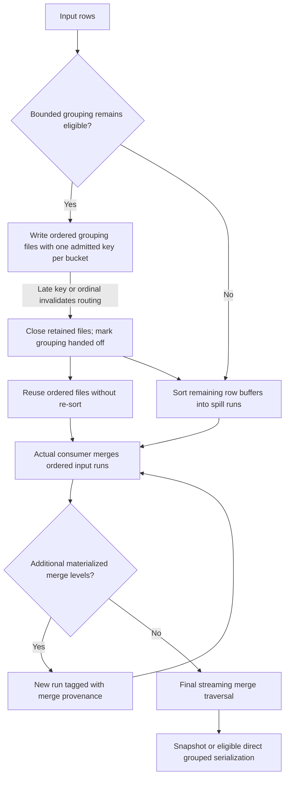

The ordinary routed frame stores its ID, ordinal, and fields. The bucket key
and its grant move to a shared immutable owner when the bucket closes. Routed
readers, merge heads, and packed rows retain this owner until they release
their last reference. A materialized merge writes the ordinary full frame.
The experimental compact spill codec keeps its full frame input.

The native Linux `experimental-wide-uniform-merge` flag raises the terminal
Uniform merge ceiling to 256 when the soft descriptor limit is at least 4,096.
The existing per-reader memory calculation and reservation still bound the
merge. Other ordering modes and physical-observation paths use the ordinary
64-run ceiling.

The algorithm can traverse multiple merge levels; the **displayed** graph never
uses a cycle to represent them. Repeated levels have bounded summaries with
row-visit counts and explicit omitted internal dependencies. Cancellation is an
interruption; decode/write failures retain their attributable partial visits.

## Default temporary storage

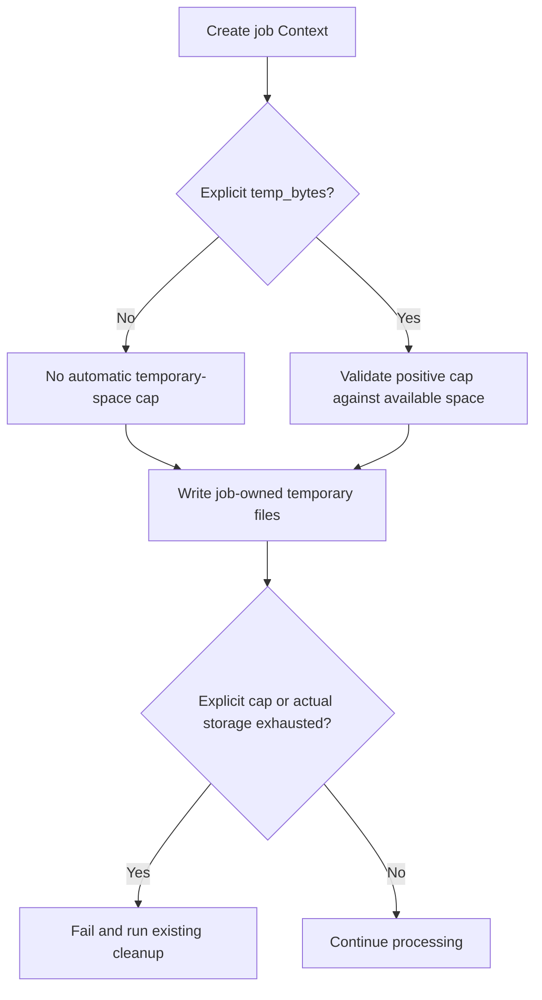

The browser no longer converts a quota estimate into a session-wide automatic
cap or reserves 20% up front. OPFS enforces actual quota, including private staged
output. Source-size estimates are advisory and do not choose execution policy.

Windows directory commit uses `MoveFileExW` with neither replacement nor
cross-volume copy enabled. Its transient UTF-16 paths are admitted through the
call. This preserves the no-replacement branch even for a competing empty
directory; originally empty destinations retain their explicit final-check/removal
path. See [the ownership audit](resource-policy-research.md#windows-directory-publication-without-replacement-2026-11-19).
