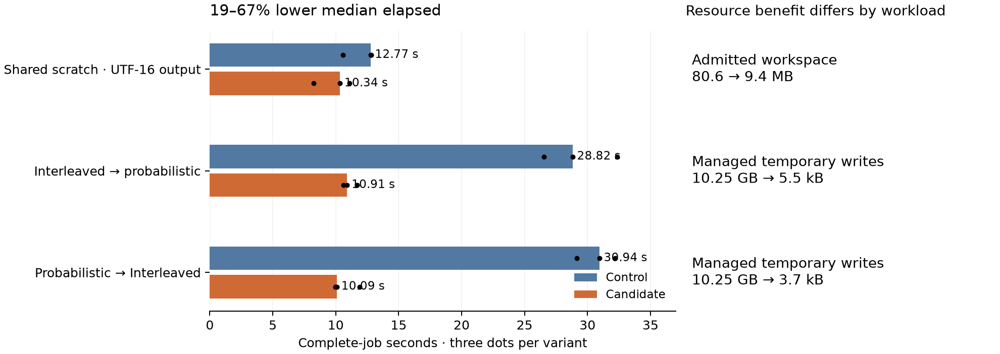

## Bounded final writers and composed pipelines (2026-11-19)

Issue #20 continues the out-of-memory investigation beyond Balanced/Shuffle.
Native opt-in count-independent grouping can now send arriving rows directly to
bounded final writers. Known fanout avoids the packed router write/read; a bounded
membership tree extends this to composed Interleaved/probabilistic operations.
A shared encoded row serializer avoids retaining each group's largest row.
No native default, release, merge or deployment is promoted.

[Reviewed samples and build identities](../../benchmarks/bounded-writers-summary-2026-11-19.json), [qualification epochs and failures](../../benchmarks/bounded-writers-checks-2026-11-19.json), wide raw ledger (local `bounded-writers-wide-2026-11-19.jsonl`), composed raw ledger (local `bounded-writers-chains-2026-11-19.jsonl`), and earlier singleton raw ledger (local `bounded-writers-prototype-singleton-2026-11-19.jsonl`) preserve distinct scopes. Raw logs, binaries and source TARs remain local and unarchived; hashes do not promise remote retrieval.

### Complete-job evidence

Corrected, consolidated writer prototypes use identical complete source/vendor
maps with feature toggles. Every job runs with one worker, 256 MiB configured
memory and a dedicated 1 GiB cgroup with swap disabled. Algorithm workspaces use
half the configured memory; reservations are not an RSS cap. Requested per-job
clean input eviction does not control WSL2 backing/Windows caches. Three paired
runs per variant follow an excluded warmup. Ranges are not confidence intervals.

| Job | Input | Control median [range], s | Candidate median [range], s | Median elapsed change |
| --- | --- | --- | --- | --- |
| Shared scratch, Interleaved16, UTF-16LE output | 1.5 GiB; 768 KiB rows | 12.77 [10.59–12.81] | 10.34 [8.26–11.08] | -19.02% |
| Interleaved4 → probabilistic 0/50/50, key stratum | 2 GiB; 8 keys | 28.82 [26.55–32.34] | 10.91 [10.60–11.68] | -62.16% |
| Probabilistic 50/50, key stratum → Interleaved4 | 2 GiB; 8 keys | 30.94 [29.15–32.20] | 10.09 [9.99–11.91] | -67.38% |

All nine eligible pair directions favor the candidate. The wide-row working peak
falls from 80,585,570 to 9,398,934 bytes (88.34% lower); these are admitted working
allocations, not RSS. A separate 32 MiB configuration completes with shared scratch
and fails local admission with per-group scratch. Both outcomes are checked for
cleanup and no kernel OOM; failure duration is not a speed comparison. Output is
approximately 3 GiB and is outside the 1 MiB managed temporary budget.

The composed jobs eliminate repeated packed-row datasets/routing passes and final
encoded snapshots. Control managed writes are about 10.25 GB per composed job, versus 5,485 and 3,703 bytes in the candidates;
they exclude normal private CSV output and are captured before final publication.
They are not total disk space or physical SSD traffic.

Every output field and source ID is checked, with conservation, encounter order,
full lineage, stages, CSV bytes, manifest and quota checks. The second pipeline's
verifier reconstructs each probabilistic parent's encounter rank before checking
its terminal round-robin membership. Fixed internal-seed comparisons against
explicit preparation establish unchanged draws in Rust controls; independent CLI
runs do not claim cross-run seeded replay. Probability-frequency/nonidentity
checks are finite diagnostics, not proofs of distributions.

### Source epochs and failed attempts

The retained binary suite is `retained-{base,terminal,fanout,shared,chain}-v1` under
local scratch. Complete source/vendor TARs and manifests identify each executable.
The measured suite predates a subsequent progress-only production correction:
per-group PlanWriters now delegate one monotonic input-stream cursor, restoring
65536-row notifications. Membership, random domains, serialized bytes, caps and
publication do not change. Final qualification and source-delta identities are
recorded separately; do not present old executable hashes as the final executable.

Broader checks caught snapshot-worker fixtures that had become direct eligible.
Two adjacent root shuffles keep those Run tests on their intended snapshot path,
using the existing redundant-shuffle rewrite. Denial, cancellation, conservation,
worker-slot and cleanup assertions remain intact. The raw-entry test counts both
validating and writing intake phases without lowering its exactly-once assertion.

An earlier singleton prototype measured 25–28% lower elapsed for Interleaved and
probabilistic jobs. Its separate cohort excluded warmup and one entire repetition
on documented concurrent-compiler overlap, before reading completed timings. The
excluded Interleaved pair was unfavorable; preserve it and do not pool cohorts.

Wide-row warmups at 64 and 128 MiB failed local admission. The first estimate missed
the half-budget workspace ceiling; the second missed retained-buffer doubling as
variable-width IDs gained a digit. A 256-row allocation census demonstrated the
fitting 256 MiB configuration before fresh full runs. Old warmups remain failed or
superseded, not extra observations. A byte-oracle mistake sorted names lexically;
it was fixed to use manifest lineage. Its full failure log is preserved.

The first-group publication is retained as final owner rather than creating a new
aggregate publisher at EOF. This preserves its original destination witness and
rejects an empty destination created after ingestion started. A regression control
covers that race. Construction declares Vec grants before their live owners so
failure unwinds allocations before grants. Single and tree paths share one Writers
owner and original PlanWriter chunk/cap construction.

### Prior art, requirements and residual costs

[qsv 29's one-pass partition implementation](https://github.com/dathere/qsv/blob/313132b8e25cbc2f1da0f72a805da86b7c84f179/src/cmd/partition.rs)
keeps key-to-writer state. Its `--limit 0` mode is unbounded in fanout; Chopper's
configured bound permits the same no-row-spool idea without unbounded writer
state. Unknown-cardinality Partition remains on its existing router/sort path.
This investigation changes neither qsv nor DuckDB and makes no fresh cross-tool
timing claim unless a separately recorded comparator cohort is completed.

[Pinned DuckDB COPY state](https://github.com/duckdb/duckdb/blob/d54cbbe3df17e8e5ce68312f483b4155836112aa/src/execution/operator/persistent/physical_copy_to_file.cpp)
separates sinking/flushing states, thresholds and delayed partition buffers;
[CSV export](https://github.com/duckdb/duckdb/blob/d54cbbe3df17e8e5ce68312f483b4155836112aa/src/function/table/copy_csv.cpp)
selects regular, batch or parallel execution according to ordering capabilities.
Its [reported overlapping-flush memory bug](https://github.com/duckdb/duckdb/issues/25920)
reinforces accounting for in-flight buffers; no claim is made that our fixtures
hit that bug. Chopper's new path remains synchronous and explicitly admitted.

Strict validation, logical digests, exact quotas, serialized caps, metadata and
atomic publication remain requirements. Packed spools and final Run snapshots
are implementation choices for these eligible jobs: their removal does not relax
those contracts. Explicit internal preparation retains exact encoded snapshots.
The previous report's hot 2 GiB digest component (~1.06 s), parser/copy differential
(~0.069 s), and preserved real-sync diagnostic (~0.60 s within a 12.61 s job) are
workload-specific attribution clues, not additive savings or feature-toggle job
comparisons. qsv's unquoted empty serialization saves about 16 MiB on the narrow
2 GiB fixture (~0.78%); it does not explain the full gap.

Prefixes, file buffers and membership metadata remain per configured group/tree
node. Wide headers or high metadata can therefore admit less readily than a
sequential traversal; all denials are terminal with cleanup. Shared row scratch
removes multiplicative row-buffer retention. ZIP, output codecs, high fanout,
unsupported stages/depth, observations and WASI keep their documented fallbacks.
Future work belongs to issue #20 rather than a second local backlog.

### Platform correction and delivery boundary

The Windows race control exposed `std::fs::rename` replacing a competing empty
directory. Publication now calls
[MoveFileExW](https://learn.microsoft.com/en-us/windows/win32/api/winbase/nf-winbase-movefileexw)
with zero flags, excluding replacement and cross-volume copy. Admitted UTF-16
buffers preserve disk/UNC verbatim paths and reject interior NUL. The ownership
[audit](../../resource-policy-research.md#windows-directory-publication-without-replacement-2026-11-19)
records capacity and drop ordering. An actual native NTFS probe passes for 332-code-unit
Unicode paths, including an originally empty destination. Windows test failures
are retained; final status and exact source identities are in the checks artifact.
Linux and WASI publication mechanisms retain their existing contracts.

The standalone/native Shuffle and Shuffle–Partition extension has functional
controls and prepared experiments but no new complete-job timing cohort in this
window. It remains an unmeasured opt-in prototype. The corrected singleton
Interleaved matrix is also prepared but not launched. No fresh qsv/DuckDB or
native Windows performance is claimed. Default native and hosted WASI artifacts
are restored; no commit, PR, merge or deployment is made.

The chart uses informative alt text, a figcaption and a semantic data table
following the accessibility/html guides ("Provide semantic data tables as
alternatives"; "specify width and height on all `` tags"). Its static PNG/SVG
artifacts use Matplotlib; its in-thread wrapper adds no application code.
