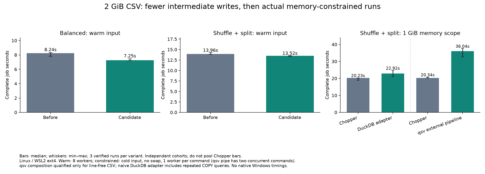

## Out of memory data movement and cache admission (2026-11-18)

This continues issue #20 after the Analyze/Run work. The new implementation is
opt-in: `experimental-terminal-shuffle`, `experimental-counted-balanced`,
`experimental-direct-decode` and Linux `experimental-cgroup-cache-headroom`.
No new experimental default is promoted by these measurements.

### Reviewed complete-job comparisons

[Lossless source selectors, frozen binaries, source maps, samples and metrics](../../benchmarks/oom-data-movement-summary-2026-11-18.json)
identify every reviewed cell. The summary copies original measurement JSON/JSONL
without changing their bytes into adjacent ignored `oom-*-raw-2026-11-18` artifacts.
These originals and full runner logs remain local and unarchived; the committed
projection records their hashes and locations, not a remote retrieval guarantee.
Checkout-root prefixes are removed only in the derived projection.
The source manifests include dirty native source and vendored dependencies; HEAD
alone does not identify a binary. These are independent cohorts, never pooled.

Seconds are median [minimum–maximum], three verified runs per variant. Percentages
use the first variant's median as denominator. Every paired sign favors the
candidate in the four rows below. Small samples do not establish tail behavior.

| Complete Run | Baseline seconds | Candidate seconds | Reduction |
| --- | ---: | ---: | ---: |
| Balanced, warm 2 GiB, 256 MiB working budget, 8 workers | 8.245 [7.798–8.320] | 7.248 [7.210–7.449] | 12.09% |
| Uniform Shuffle → Balanced, warm 2 GiB, 1 GiB working budget, 8 workers | 13.962 [13.856–14.268] | 13.525 [13.336–13.547] | 3.13% |
| Shuffle → Balanced, actual 1 GiB memory scope: naive DuckDB adapter vs Chopper | 22.916 [21.129–24.653] | 20.229 [18.812–20.309] | 11.73% |
| Shuffle → Balanced, actual 1 GiB memory scope: qsv external pipeline vs Chopper | 36.042 [32.761–37.582] | 20.337 [20.250–20.733] | 43.58% |

The warm comparisons use excluded per-variant warmups and alternating pairs.
The DuckDB constrained cohort has its own excluded warmup. The qsv confirmation
has three fresh alternating pairs after a separate successful calibration; its
calibration is not pooled. The original fixture contains 8,388,608 four-column
records, repeated payload, no embedded field newlines, divisible by eight. A
separate approximately 497 MiB field-rich screen has **three**, not four, columns,
Unicode and embedded newlines. Earlier frozen screen-plan labels incorrectly say
four columns; their bytes remain preserved. On that shape, terminal Shuffle
improves 6.14% and count-first Balanced 7.38%, separately from the large cells.

The complete-job clock includes launch, validation, all processing and output,
publication and native/adapter cleanup. Fixture preparation, independent all-field
verification and post-verification output deletion are outside. Verification
checks unique IDs, conservation, exact quotas, fields, metadata and applicable
caps. These runs use Linux WSL2/ext4, Ryzen 5800X and approximately 62 GiB host RAM.
Warm working-budget tests exceed engine memory, not host RAM. Constrained tests
use a fresh foreground cgroup per job, `memory.max=1 GiB`, swap disabled and input
`POSIX_FADV_DONTNEED` before its clock. WSL backing-device cache is uncontrolled;
these are not native Windows timings or physical SSD throughput measurements.

### Why the retained changes help

Direct terminal Shuffle sends the final sorted traversal into private grouped
publication instead of writing an encoded snapshot and copying it again. Managed
temporary bytes written fall from 4,949,280,036 to 2,785,019,352 (about 44%) on the
large cell. Its 3.13% elapsed gain is below the earlier 5% timing gate; the owner's
subsequent resource-based acceptance criterion supports retaining the experiment.
Private destination staging is outside these counters: this does **not** prove a
44% reduction in physical I/O or total peak disk occupancy.

Count-first Balanced strictly parses/counts plain UTF-8 input, then reopens and
emits exact consecutive quotas. Header/count/logical digest and source identity
must agree before publication. Managed temporary peak falls from 2,650,801,679
bytes to 1,496 bytes; approximately 2.16 GB of private output is still required.
This trades extra parsing/hash CPU for eliminating the retained input Dataset.
Compressed and other-encoding sources retain the single-decode implementation;
a bounded signature peek chooses eligibility. Observed execution, explicit
prepared snapshots and browser counted execution keep their existing contracts.

Actual memory pressure exposed another bottleneck: raw cgroup `max-current`
treats clean inactive file cache as unavailable, denying a small working grant
while the kernel can reclaim cache. The diagnostic failed admission, **not** kernel
OOM. Its approximately 57 MiB `current` in the error is a reduced admission ceiling,
not measured live allocation. At the sampled peak, about 960 MB was file cache,
94 MB anonymous, and the clean inactive estimate approximately 805 MB.

The opt-in cache policy credits only a conservative own-leaf estimate:
`min(inactive_file,file)-shmem-file_dirty-file_writeback`, saturating at zero.
It validates the full ancestry, requires readable zero protection settings and
no descendants, never credits sibling cache, pays any over-limit deficit, keeps
`memory.high` conservative and retains raw partial bounds on read failure. The
same half-headroom margin and aggregate ceiling remain. This rescued the native
workload; all constrained successful scopes reached the 1 GiB total-memory peak,
with zero kernel OOM kills. **Estimated reclaimability is not guaranteed:** pins,
protections and nontransactional samples remain reasons to keep this opt-in.

### Fairness and upstream prior art

DuckDB 2.0.0's measured naive adapter materializes all-VARCHAR input ordered by
random key, counts it, then issues eight exact-quota LIMIT/OFFSET COPY statements.
It uses a 256 MiB engine budget and one worker, as does constrained Chopper. This
is an adapter comparison, not a claim about the best possible DuckDB query.
A more direct single partitioned COPY was independently checked on tiny fixtures,
including nondivisible counts, then tried with default buffers, flush threshold
8,192, and one open writer. All three large attempts exhausted DuckDB's 256 MiB
internal budget. Their failures are retained and excluded from throughput rows.
The earlier eight-worker constrained DuckDB attempt also failed pin admission.

qsvlite 29.0.0 is composed as `enum --uuid4 | select 5,1-4`, line-mode `extsort`
with 64 MiB requested memory and one job, `select 2-`, and `split --chunks 8`.
Every pass and intermediate deletion is timed. UUID generation and the first
select are two concurrent single-thread commands; no equal single-core CPU cap
is claimed. qsv's default random sort is resident; its documented UUID approach
provides an external-sort alternative. This composition is qualified only for
line-free CSV with divisible quotas, not arbitrary multiline records or every
Chopper grouping contract. Different empty-field quoting produces about 0.8%
less output for qsv; logical fields match. Median process RSS is approximately
87,632 KiB for Chopper and 139,304 KiB for the qsv pipeline, separately from the
1 GiB cgroup peak that includes file cache.

Source inspection is pinned to
[qsv 313132b, enumerate](https://github.com/dathere/qsv/blob/313132b8e25cbc2f1da0f72a805da86b7c84f179/src/cmd/enumerate.rs),
[qsv buffer configuration](https://github.com/dathere/qsv/blob/313132b8e25cbc2f1da0f72a805da86b7c84f179/src/config.rs)
and [DuckDB d54cbbe](https://github.com/duckdb/duckdb/tree/d54cbbe3df17e8e5ce68312f483b4155836112aa).
qsv uses reusable CSV records and larger I/O buffers; DuckDB amortizes operations
through vectors and sorted runs. Chopper already has lending packed merge rows,
reusable traversal fields and inline keys; those are existing optimizations.
[DuckDB's partitioned write contract](https://duckdb.org/docs/2.0/data/partitioning/partitioned_writes)
explains per-partition writer costs. The
[Linux memory interface](https://docs.kernel.org/admin-guide/cgroup-v2.html#memory-interface-files)
defines cache/protection counters; it does not promise that all inactive cache is
immediately reclaimable.

### Requirements, negative results and decision

Chopper's exact quota proof, strict serialized byte caps, arbitrary quoted CSV,
logical source digest, resource admission and atomic no-replacement publication
remain required. The measured Dataset/snapshot deltas above quantify avoidable
traffic around those requirements, not the isolated price of each guarantee.
The existing hot-row component probe measures approximately 1.064 seconds to
hash 2 GiB and 0.620 seconds for random keys. Two digest passes therefore suggest
roughly 2.1 seconds of hashing component work, **not** a measured 2.1-second
whole-job saving or a safe reason to remove source-change detection. A separate instrumented native Balanced diagnostic preserves the real
`fsync`/`fdatasync` calls: nine successful sync calls total 0.574 seconds of a
7.201-second verified complete job (about 8%). This one warm run measures blocking
sync time, not a paired no-sync counterfactual or a universally removable cost.
Its source/interposer hashes and raw receipt selector are in the summary.

A compact second-pass emitter was rejected: only approximately 1–2% elapsed
changes, overlapping ranges and no meaningful RSS/I/O saving. The original owned
emitter is restored. Direct decoder output removes one existing byte copy using
the same 32 KiB capacity and grants. Differential tests cover encodings, BOM,
fragmentation, malformed input and retry after InvalidData. Whole-job screens
show only 0.46–0.71% improvement for Balanced and a 2.61% regression for Shuffle;
there is no supported throughput promotion. It remains an isolated experimental
copy-reduction avenue. BLAKE3 `pure` already retains AVX2 Rust intrinsics on this
host; assembly is not a missing-SIMD fix to promote speculatively.

Linux formatting, default/all-feature workspace lint/tests and portable-core
all-feature WASM check passed. Native Windows all-feature workspace lint/tests
passed in a fresh NTFS source snapshot. [Browser prototype and default restoration
coverage and native receipt selectors](../../benchmarks/oom-data-movement-checks-summary-2026-11-18.json)
are recorded separately; it is not the entire
hosted acceptance suite. Frozen benchmark binaries predate small error-path and
eligibility refinements; their source manifests identify that fact. Correctness
receipts cover the refined source, not a fabricated rerun of its performance.

Future coverage of Interleaved, Partition modes, Assign exact/probabilistic,
remaining Shuffle paths, encodings/codecs/caps and composed pipelines belongs to
issue #20. Current OOM work retains priority. Historical evidence regeneration
remains blocked by a duplicate-member archived TAR bundle; no validator or
historical original is weakened to make new evidence appear fully indexed.
