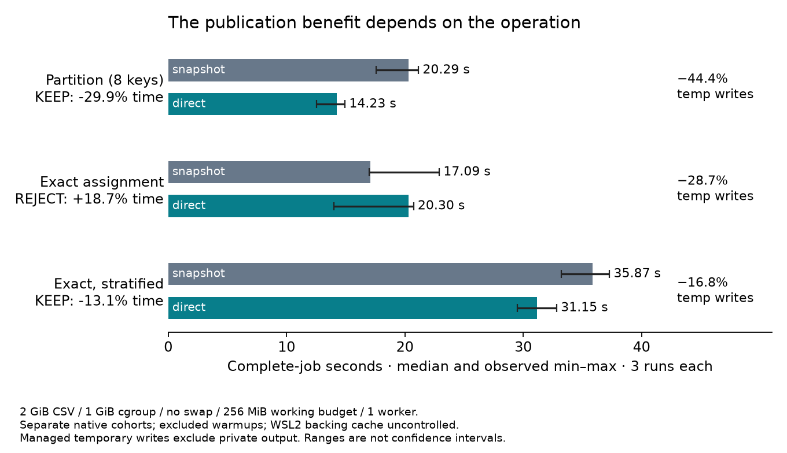

## Partition routing and assignment tradeoffs (2026-11-18)

Issue #20 continues beyond Balanced/Shuffle. The native-only
`experimental-terminal-routing` build now permits a single plain-output Partition
or stratified exact assignment, alongside its existing Interleaved and probabilistic
assignment cases. It retains tuple comparison, original exact quota/membership
construction, encounter order, strict serialized caps and atomic publication.
Final traversal writes grouped private output without the encoded snapshot/copy.
Explicit internal preparation retains its snapshot; WASI excludes this extension.
Unstratified exact assignment retains the snapshot path after a measured regression.
No new default, release or deployment is promoted.

[Reviewed samples, selectors, source/build identities and resource scopes](../../benchmarks/partition-routing-summary-2026-11-18.json)
and [final source validation receipts](../../benchmarks/partition-routing-checks-summary-2026-11-18.json)
are derived projections, not additional observations. Raw JSONL, runner receipts,
failed attempts, binaries and full source/vendor archives remain local and
unarchived. Paths and hashes do not promise remote retrieval.

### Independent native comparisons

Each cell has its own excluded warmup and three rotated complete jobs per variant.
The input has 8,388,608 four-column records, approximately 2 GiB. Native working
budget is 256 MiB with one worker, inside a dedicated 1 GiB cgroup with swap
explicitly disabled. Per-job `POSIX_FADV_DONTNEED` requests clean input eviction;
WSL2/ext4 backing and host caches are uncontrolled. These establish neither
physical-device cold throughput nor native Windows performance.

Seconds are median [minimum–maximum]; percent changes use the control median as
denominator. Do not pool cells or infer tails from three repetitions.

| Complete job / experiment | Control | Candidate | Decision |
| --- | ---: | ---: | --- |
| Partition, eight alternating keys: snapshot → direct | 20.290 [17.572–21.151] | 14.228 [12.542–14.940] | Retain opt-in: 29.88% lower elapsed, all pairs favorable |
| Unstratified exact 0/50/50: snapshot → direct | 17.094 [17.003–22.910] | 20.296 [13.982–20.735] | Reject: 18.73% higher median, two adverse pairs |
| Eight-stratum exact 0/50/50: snapshot → direct | 35.866 [33.226–37.296] | 31.150 [29.523–32.831] | Retain opt-in: 13.15% lower elapsed, all pairs favorable |
| Immediate bounded routing instead of first-buffer classification | 15.290 [13.376–16.614] | 16.159 [15.076–17.986] | Remove live prototype: 5.69% higher median misses declared 5% regression limit |

The clock includes CLI startup, complete validation/digesting, intermediates, CSV
writes, native finalization and publication. Fixture generation, independent
verification and successful payload deletion are outside. Verification checks
all fields/IDs, conservation, exact tuple or allocation quotas, per-stratum quotas,
encounter order, manifest lineage/counts/stages and file hashes. Exact internal
membership also matches fixed-internal-entropy snapshot parity tests; CLI jobs
obtain independent entropy and have no cross-plan seeded replay guarantee.

Partition managed temporary writes fall from 4,873,782,652 to 2,709,521,976 bytes
(44.41%). Stratified exact writes fall from 12,893,291,837 to 10,729,031,077
(16.79%); both retain the original sorting/routing/spill work. The latter still
has one routing fallback and 44 sort runs. Unstratified writes fall 28.73%, but
that does not meet this experiment's latency acceptance. The selector and a
regression control explicitly keep its snapshot fallback.

These counters exclude private destination staging and are returned before
publication. In particular, the snapshot's later encoded-copy read is absent from
returned read counters. They are not total disk, physical I/O or RSS reductions.

### Cross-tool Partition comparison

A separate cohort uses the final retained direct-publication binary, three rotated
jobs per tool after a warmup, under the same declared workload/resource constraints.

| Fixed eight-key Partition job | Median [min–max] seconds |
| --- | ---: |
| Chopper direct-publication experiment | 13.760 [13.307–18.446] |
| DuckDB 2.0.0: materialize once, eight filtered COPY operations | 21.702 [20.287–22.953] |
| qsv 29.0.0 partition, `--limit 0` | 3.032 [2.525–3.064] |

Every native pair is faster than this DuckDB adapter; every qsv pair is faster
than native. qsv is approximately 4.5 times faster at these medians. This is a
comparison of recorded complete implementations, not a universal tool ranking.

DuckDB uses explicit VARCHAR columns, `force_not_null` for every field,
`allow_quoted_nulls=false`, insertion-order preservation and one worker. It
materializes once, discovers sorted keys, then performs one ordinary filtered
COPY per key. Materialization, all eight scans and output writes are clocked.
Its [documented single-table/WHERE/COPY order guarantees](https://duckdb.org/docs/2.0/sql/dialect/order_preservation)
and independent checks permit omitting a redundant `ORDER BY id`. An earlier
oversorted adapter's large warmup is excluded entirely.

Three tiny direct partitioned-COPY controls are retained as failures, not timings:
max-open-files eight produced nine files; sixteen produced eight files but wrong
encounter order; adding COPY `ORDER_BY(id)` produced sixteen files. The unchanged
verifier rejected each. This concerns those adapters/settings and does not prove
that DuckDB cannot implement an efficient equivalent pipeline.

Pinned [qsv partition source](https://github.com/dathere/qsv/blob/313132b8e25cbc2f1da0f72a805da86b7c84f179/src/cmd/partition.rs)
shows `--limit 0` directly maps keys to CSV writers in one pass. The default bounded
file-descriptor mode first collects unique keys and rescans per batch. Unlimited
writers are practical for this known eight-key fixture; they are not a bounded
catalog for arbitrary cardinality. Chopper already routes this low-cardinality
cell without comparison sorting: both native variants report one routed grouping
and zero sort runs. Its remaining packed-data write/read is an implementation
choice worth targeting, not a necessary consequence of canonical tuple ordering.

Native output also supplies bounded admission, strict UTF-8/CSV validation,
logical digest, caps, manifests, cleanup and atomic publication. Comparator memory
settings are not complete RSS caps; the OS cgroup constraint is checked separately.
Empty-field quoting makes native output slightly larger than qsv on this fixture;
logical text equality, rather than byte-identical CSV, is the cross-tool contract.
Do not attribute the entire remaining gap to Chopper's stronger requirements.

### Requirements and their measured cost limits

Actual tiny **qsv partition** controls preserve invalid UTF-8 and accept text after
closing quotes; native rejects both and removes private output. These extend the
earlier Split-only findings without assuming every qsv command behaves alike.
The actual command receipts are embedded in the reviewed summary.

One separately instrumented complete native Partition job preserves real libc
`fsync`/`fdatasync`: nine successful calls total **0.601350 s** inside a 12.610521 s
job, about 4.8% of that clock. This is observed blocking-call time, not a paired
no-sync saving or complete kernel-I/O attribution. Native synchronizes files
before its atomic commit; qsv's pinned partition loop flushes CSV writers without
supplying this native publication contract.

The cached compact logical-hash component corresponds to roughly **1.06 s per
2 GiB** at this record shape. It omits parsing/I/O/admission and is not an isolated
whole-job removal estimate. The earlier [strict decoder probe](pipeline-publication-and-byte-cap-comparisons-2026-11-18.md)
differs from a raw Cursor by about **0.069 s per 2 GiB** of hot ASCII logical input;
that includes copies/read granularity, not isolated UTF-8 or CSV validation cost.
Native empty-field quoting adds **16 MiB**, about **0.78%**, relative to qsv's
roughly 2 GiB serialized output here. Caps and invalid-input bounds are preserved,
but their separate CPU cost is not measured. Per-row admission and statistics
have no isolated cost estimate in these runs. Do not add these component and
instrumented figures, or claim they explain the entire cross-tool gap.

The remaining native router writes and rereads about **2.71 GB of packed rows**.
A bounded final-writer experiment should target that pass while retaining strict
validation, caps and atomic commit. Configured Interleaved/probabilistic fanout
provides a simpler first case than unknown Partition cardinality: admit the writer
set before emission, preserve shared chunk decisions and canonical metadata/naming,
then compare complete jobs and high-fanout/late-wide/failure cleanup. No new
multiplexed writer is implemented here; future acceptance belongs to issue #20.

### Resource finding withheld after the elapsed rule

The immediate-routing prototype reused existing `Sorter::streaming`, its maximum
of 64 routes and memory-dependent bound, and one-way reuse of ordered files when
a late key invalidates routing. It admitted no new unbounded catalog or replay.
A conservative advisory selector restricted it to single plain-output Auto
Partition jobs, regular plain UTF-8 inputs larger than the resolved working
budget and no blank-line skipping. Fitting, container, other-encoding and explicit
Sort cases retained their paths. The original counted-input signature peek was
shared without changing its eligibility semantics.

At eight keys, median peak accounted workspace falls from 67,856,816 to 747,960
bytes (98.90%). GNU-time reported largest-process peak RSS falls from 76,044 to
16,180 KiB (78.72%). Helpers set a floor on that reported metric; it is not summed
RSS. Cgroup peak includes cache, while reservations count working allocations.
Two elapsed pairs favor the prototype, but the third is sufficiently adverse to
miss the predeclared 5% median regression limit. This does not establish universal
slowness; it does reject integration under this experiment's rule.

The source, matched feature-OFF/ON builds and patch are preserved. The live flag,
selector changes and added prototype tests are removed by restoring the exact
retained source archive. The higher-cardinality large matrix was not launched
after the first acceptance condition failed. Its bounded fallback was qualified
only in the prototype's correctness pass against an actual external-Sort oracle.
A future shared-capacity workload could test whether this large headroom saving
changes completion or aggregate throughput; that is new work in issue #20.

### Count-proof screens and corrections

Replacing the first compact logical hash with two raw byte streams alone loses:
median 0.066173 to 0.069126 seconds per 128 MiB cached-row component, three pairs,
all adverse. The original compile failed only because the pinned Rlib filename
lacked the required `lib` prefix; its failed receipt and revised copy remain.

An isolated count-only `FieldTarget` reuses the unchanged strict parser state
machine and discards validated fields. Against a frozen original parser it passes
1,218 count/error controls covering short reads, malformed UTF-8/CSV, BOM,
blank/CRLF, working limits, quoting/escapes and encodings. Including both raw proof
hashes, it lowers a hot 2 GiB logical component from 1.956097 to 1.736726 seconds
(11.21%). That misses its declared 15% advance threshold, with no material whole-job
resource saving on this fixture. No core API or native byte-proof path is integrated.
The common second strict parse/public digest is omitted and admission is mocked;
these are not whole-job or out-of-memory speedups.

The input wrapper reads four signature bytes then seeks back to zero. It does
not chain a four-byte prefix; raw proof reads start with normal decoder chunks.
BLAKE3's pinned `pure` backend still uses Rust SSE/AVX2 intrinsics on this CPU;
calling it scalar would be incorrect. No RNG algorithm experiment is reopened.

### Delivery, validation and next boundary

Current retained native source matches the frozen direct-publication build.
Linux formatting, default/all-feature workspace lint/tests and core WASM check
passed. Fresh native Windows all-feature lint/tests passed. The routing-flag WASI
small hosted graph suite passed and default production WASI/hosted assets were
restored; this is not the full hosted acceptance suite. The native release binary
was rebuilt with default features. Source identities and raw receipts are recorded
in the linked checks summary.
No performance observation is reassigned to a later binary merely because it
passed correctness checks. Experimental eligibility remains opt-in and unmerged.

The fixture hard-link setup attempt is preserved as invalidated: creating the
link changed the declared source's ctime even though bytes stayed identical.
No benchmark jobs launched from that attempt. Revised ordinary copies preserve
source identity. The private-Context grouping-field compile failure is also
retained; the prototype read admitted Job resources instead.

The historical duplicate-member archive hydration error still blocks full
catalog/registry/views refresh. No historical original or validator is weakened.
Remaining pipeline/mode coverage and bounded final-writer design belong to issue
#20; this checkpoint does not redefine the user's all-functions objective.
