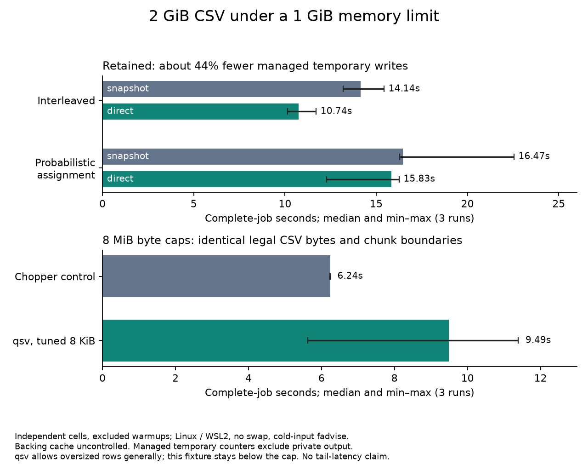

## Pipeline publication and byte cap comparisons (2026-11-18)

This continues issue #20 beyond Shuffle/Balanced. The retained native-only
`experimental-terminal-routing` build permits one plain-output Interleaved or
probabilistic assignment operation, including strata. Its existing router,
sorter/spill, membership domains and encounter order remain; final traversal
writes grouped private output without an encoded snapshot/copy. Explicit internal
preparation retains a snapshot. No new experimental default is promoted.

[Reviewed source selectors, samples, metrics and frozen builds](../../benchmarks/pipeline-publication-summary-2026-11-18.json)
and [current retained-source checks](../../benchmarks/pipeline-publication-checks-summary-2026-11-18.json)
are derived projections, not additional observations. Full original JSONL,
runner logs, binaries and complete source/vendor archives remain local and
unarchived. Their locations and hashes do not promise remote retrieval.

### Independent complete-job results

All large cells use 8,388,608 four-column records, approximately 2 GiB input,
256 MiB native working budget and one worker, in a dedicated 1 GiB cgroup with
swap disabled. Input receives `POSIX_FADV_DONTNEED` before each clock. WSL2/ext4
backing cache is uncontrolled. This establishes neither native Windows throughput
nor physical-device bandwidth. Kernel peak includes file cache and is not RSS.

Each cell has an excluded warmup and three rotated measured jobs per variant.
Seconds are median [minimum–maximum], with reductions using the first median as
denominator. Do not pool these cells or the separate 128 MiB calibration.

| Complete job | Before/control | Candidate/comparator | Interpretation |
| --- | ---: | ---: | --- |
| Interleaved(8), snapshot → direct | 14.144 [13.199–15.423] | 10.738 [10.140–11.701] | 24.08% lower elapsed; every pair favorable |
| Probabilistic 0/50/50, snapshot → direct | 16.469 [16.274–22.543] | 15.829 [12.278–16.249] | 3.89% lower elapsed; every pair favorable |
| Plain-output 512 KiB buffer, Balanced | 9.690 [7.541–11.292] | 8.307 [6.356–9.929] | Mixed paired signs; no adoption |
| Plain-output 512 KiB buffer, Shuffle → Balanced | 18.520 [18.020–19.704] | 20.252 [19.890–21.729] | 9.35% slower; every pair slower; rejected |
| Byte caps, owned-record serializer fit | 6.237 [6.232–6.237] | 6.279 [6.279–6.379] | Slower every pair, extra scratch; rejected |
| Byte caps, Chopper control vs tuned qsv | 6.237 [6.232–6.237] | 9.485 [5.627–11.389] | Chopper median lower; qsv wins one pair; no tail claim |

The clock includes launch, validation/digesting, intermediate/output writes and
product finalization/cleanup. Native sync and atomic publication remain included.
Generation, independent verification and successful payload deletion are outside.
All fields/IDs, conservation, encounter order, manifests/stage metadata and
applicable caps are checked. Interleaved membership uses independent modulo
checks. Probabilistic CLI runs use independent randomness: conservation and a
loose finite distribution diagnostic supplement exact internal-seed snapshot
parity tests; they do not prove uniformity or cross-plan seeded replay.

### Resource retention and rejected hypotheses

Interleaved managed temporary writes fall from 4,882,171,172 to 2,717,910,488 bytes.
Probabilistic writes fall from 4,882,170,370 to 2,717,909,610. The roughly 44%
reduction supports retaining the latter despite its sub-5% timing change, under
the owner's resource-based acceptance criterion. Private destination staging is
excluded: these are not total peak-disk or physical-I/O reductions.

The larger writer costs another 448 KiB per live native plain sink. Balanced
system CPU falls from median 1.77 to 1.39 seconds, but that does not justify the
consistent Shuffle regression. Its feature/helper are removed; frozen binaries,
source archives, attempts and patch remain. No buffer sweep follows.

The serializer prototype derived a conservative ASCII/UTF-8 bound from an
immutable owned slice, admitted larger scratch on growth, then bypassed generic
growth bookkeeping only when the bound fit. Arbitrary `Clone` iterators cannot
prove such a bound; an adversarial-clone test protected that boundary. Correctness
and admission controls passed, but all large pairs were slower and extra retained
capacity brought no resource benefit. The API, feature and branches are removed;
only historical source/test evidence and patch remain.

Counted Balanced now drops its first-pass header/proof after successful comparison,
before diagnostics and publication. A 512 KiB header control verifies final live
reservations contain less than two header payloads while returned Analysis retains
its complete admitted header. This creates finalization headroom; it does not
reduce the earlier peak when both headers must overlap, or prove lower RSS.

### Competitor tuning and actual contract differences

Pinned qsv 29.0.0 resolves to
[313132b](https://github.com/dathere/qsv/tree/313132b8e25cbc2f1da0f72a805da86b7c84f179).
Its [byte-cap splitter](https://github.com/dathere/qsv/blob/313132b8e25cbc2f1da0f72a805da86b7c84f179/src/cmd/split.rs)
constructs a measurement CSV writer per row, then writes the row again to output.
[Configuration](https://github.com/dathere/qsv/blob/313132b8e25cbc2f1da0f72a805da86b7c84f179/src/config.rs)
uses a 512 KiB default and documents `QSV_WTR_BUFFER_CAPACITY`.
[Its actual CSV dependency](https://github.com/dathere/rust-csv/blob/1be3567a8d18c62bd558db0ba6b0cd6f3fcf8527/src/writer.rs)
constructs a zero-initialized writer buffer. This source pattern motivates testing
8 KiB, rather than claiming a win against an avoidably costly default.

One independently verified 128 MiB calibration per variant gives Chopper 0.515 s,
qsv default 3.171 s and qsv 8 KiB 0.415 s. These are screening observations, not
out-of-memory results. The large comparison therefore uses qsv's faster override,
with a 128 KiB reader and one worker. No further qsv buffer tuning is performed.

Large byte-cap inputs replace empty fields with nonempty ASCII and adjust payload
length to retain 256 serialized bytes per row. Both tools then produce identical
CSV bytes, 257 files, identical boundaries and strict 8 MiB caps on this fixture.
Do not generalize that equivalence: tiny actual controls show these qsv split
invocations preserve invalid UTF-8, accept text after a closing quote, and emit a
2,059-byte CSV under `--kb-size 1`. Chopper rejects all three and removes private
output. [ByteRecord](https://docs.rs/csv/1.4.0/csv/struct.ByteRecord.html) explicitly
permits non-UTF-8 bytes. These findings concern the recorded commands, not every
qsv operation. Native atomic publication is also not supplied by this adapter.

A separate hot ASCII probe reads 2 GiB logical bytes from a repeated 128 MiB
in-memory source: existing strict DecodeReader median 0.137896 s versus raw Cursor
0.069389 s, three alternating component pairs after a warmup. The difference
includes copies and read granularity; it is not isolated UTF-8 validation, CSV
parsing, I/O or an additive whole-job saving. Earlier digest and sync estimates
retain their original component/workload caveats.

### Pause checkpoint and limits

Linux formatting, default/all-feature workspace lint/tests and portable-core WASM
check passed. Fresh native Windows all-feature lint/tests passed. A WASI build
with the routing flag retained snapshot graph semantics in the small acceptance
suite, confirming exclusion there; default WASI/hosted assets were restored.
This is not the entire hosted acceptance suite. Benchmark source snapshots predate
the separate header-release refinement; current correctness receipts cover it.

A counted CSV-byte-proof source prototype is preserved separately and removed
from live code. Its EOF/ownership, mutation and parity controls passed, but it has
no matching release/performance evidence. Bulk hashing can add a third hash stream;
the existing first-pass compact digest is already batched. Do not assume a win
from the older component estimate. A quote-aware counting scanner is a future
hypothesis, not implemented behavior; BOM, skipped blank lines, CRLF, escaped
quotes, stable-input proof and strict validation before publication need proof.

Remaining operation/mode coverage belongs to issue #20. The existing duplicate-member
archive hydration failure still blocks complete historical catalog/registry/views
regeneration; no validator or historical original is weakened. Changes remain
unmerged and opt-in, with no deployment or new release claim.
