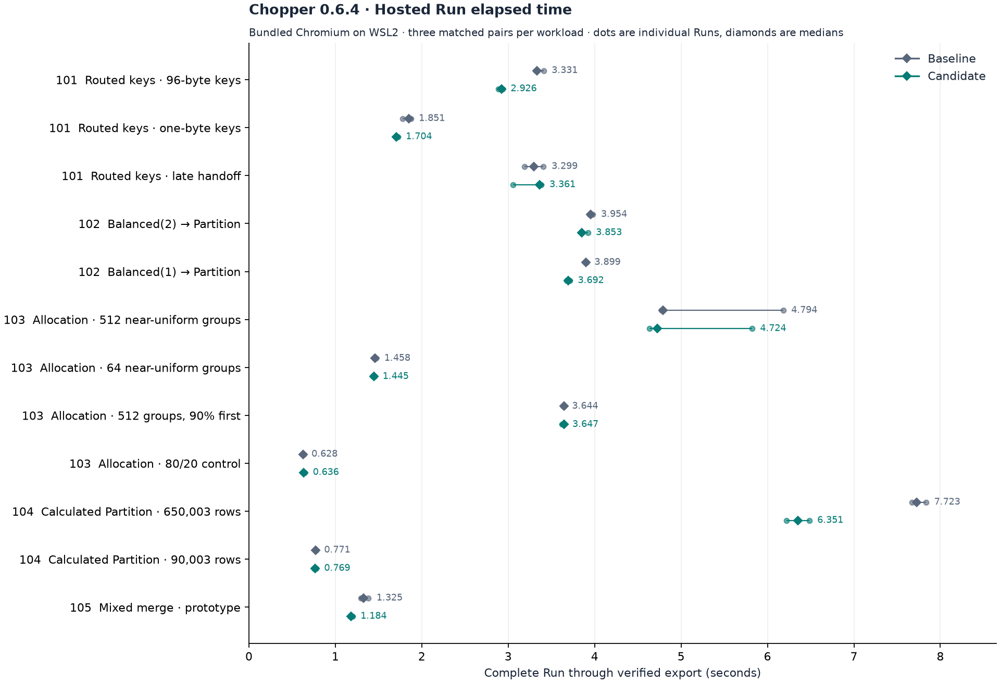

# Chopper 0.6.4

This patch speeds up routed Partition, Balanced followed by Partition,
high-fanout probabilistic allocation, and eligible hosted calculated Partition.

## Verified performance comparisons

The charts use three matched pairs per workload in bundled Chromium on
WSL2, with one worker and a 4 MiB CSV cap. The clock runs through verified
export and workspace retirement. Each comparison pins its own baseline
and candidate builds. The investigation records give the exact fixtures,
memory settings, asset identities, and individual observations. Temporary
I/O and storage figures are tracked by Chopper.

| Change | Median complete Run | Resource result |
| --- | ---: | --- |
| Routed Partition with 96-byte keys | 3.331 → 2.926 s | 67.8 MB saved in each of temporary reads, writes, and peak storage |
| Balanced(2) followed by Partition | 3.954 → 3.853 s | 62.1 MB fewer temporary reads and 300,002 of 600,003 frames scanned |
| Probabilistic allocation with 512 near-uniform groups | 4.794 → 4.724 s | All three pairs improved. The 80/20 control added about 8 ms at the median. |
| Hosted calculated Partition with 650,003 rows | 7.723 → 6.351 s | 243.6 MB saved in each of temporary reads and writes |

The late-key routing handoff had mixed elapsed results and saved 33.6 MB
of temporary writes. The mixed merge prototype improved its timed workload
but failed the matched late shared-memory control. This release keeps the
ordinary final spill.

[Routing](../performance/investigations/a-single-admitted-key-per-routed-group-2026-11-26.md) ·
[Balanced](../performance/investigations/terminal-partition-after-a-shared-balanced-range-2026-11-26.md) ·
[Allocation](../performance/investigations/cumulative-lookup-for-probabilistic-allocation-2026-11-26.md) ·
[Calculated Partition](../performance/investigations/observed-hosted-calculated-columns-followed-by-partition-2026-11-26.md) ·
[Mixed merge](../performance/investigations/mixed-hosted-uniform-merge-with-a-retained-final-batch-2026-11-26.md)

Saved Jobs use format version 1. Use the
[release-pinned schema](../job-json.md#editor-setup) for editor validation.
