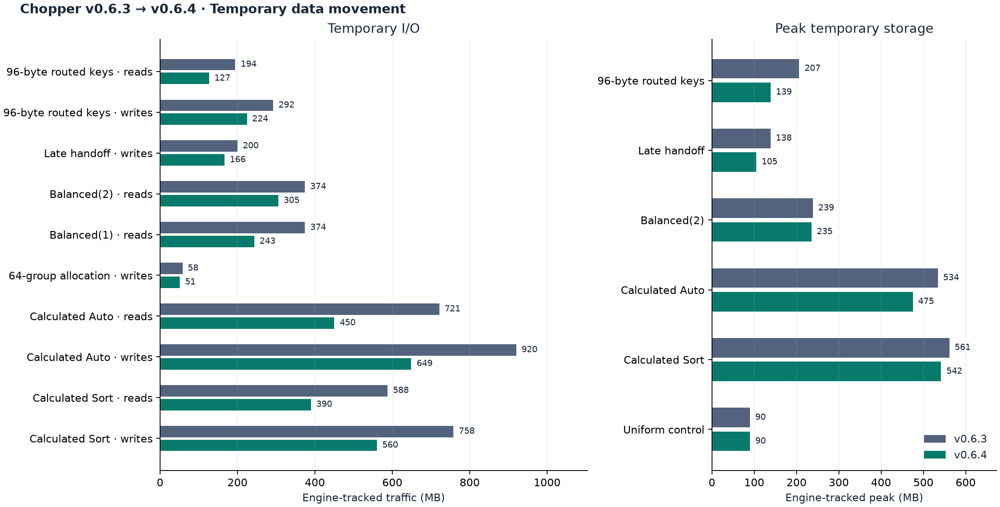

# Chopper 0.6.4

This patch speeds up routed Partition, Balanced followed by Partition,
high-fanout probabilistic allocation, and eligible hosted calculated Partition.

## Performance compared with v0.6.3

The baseline is the published v0.6.3 hosted package. The comparison uses the
engine and workers in the v0.6.4 hosted package. Each workload has three
alternating matched pairs after warmup, run with one worker and a 4 MiB CSV cap
in persistent bundled Chromium profiles on WSL2. The timer runs from the Run
request through export completion and worker retirement. Every export was
independently verified after the timer stopped. Temporary I/O and storage are
logical byte counters tracked by Chopper. Circles show individual observations,
diamonds show medians, and bars show median resource use. The
[sample data](../benchmarks/0.6.4-performance-data.json) includes asset hashes,
fixture recipes, memory settings, working reservations, and observations.

| Hosted workload | Median Run, v0.6.3 → v0.6.4 | Resource result |
| --- | ---: | --- |
| Routed Partition with 96-byte keys | 3.310 → 2.995 s | 67.8 MB saved in each of temporary reads, writes, and peak storage |
| Balanced(1) followed by Partition | 3.914 → 3.628 s | 130.7 MB fewer temporary reads |
| Balanced(2) followed by Partition | 3.982 → 3.790 s | 68.7 MB fewer temporary reads |
| Probabilistic allocation with 512 near-uniform groups | 4.782 → 4.703 s | Peak temporary storage stayed near 115.9 MB |
| Auto calculated Partition with 650,003 rows | 7.765 → 6.224 s | 270.9 MB saved in each of temporary reads and writes. Peak temporary storage fell by 59.2 MB. |
| Calculated Partition with explicit external Sort and 400,003 rows | 6.450 → 5.401 s | 197.9 MB saved in each of temporary reads and writes |

The median was about 33 ms higher for the 512-group allocation control with
90% of weight in the first group, and about 9 ms higher for the 90,003-row
calculated Partition control. The chart shows the spread across pairs. These
timings cover hosted Runs on the measured machine.

[Routing](../performance/investigations/a-single-admitted-key-per-routed-group-2026-11-26.md) ·
[Balanced](../performance/investigations/terminal-partition-after-a-shared-balanced-range-2026-11-26.md) ·
[Allocation](../performance/investigations/cumulative-lookup-for-probabilistic-allocation-2026-11-26.md) ·
[Calculated Partition](../performance/investigations/observed-hosted-calculated-columns-followed-by-partition-2026-11-26.md) ·
[Mixed merge experiment and admission finding](../performance/investigations/mixed-hosted-uniform-merge-with-a-retained-final-batch-2026-11-26.md)

Saved Jobs use format version 1. Use the
[release-pinned schema](../job-json.md#editor-setup) for editor validation.
