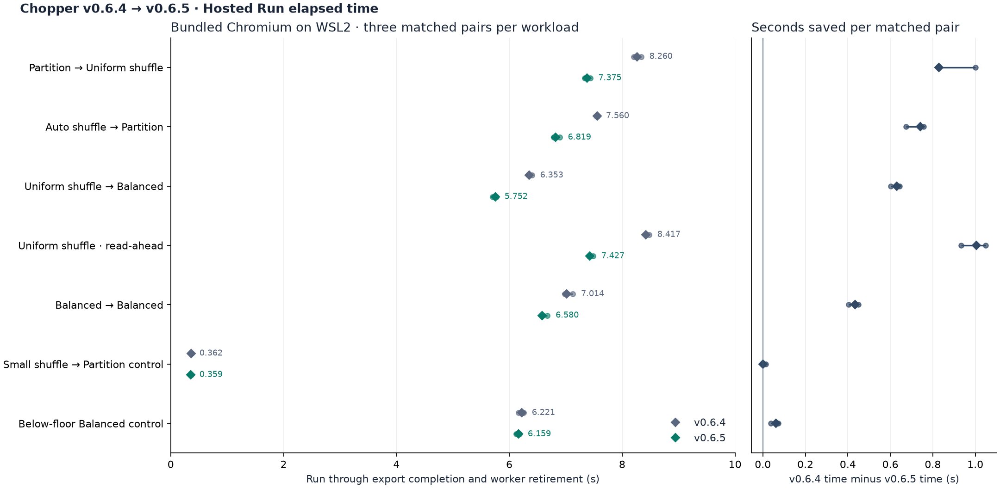
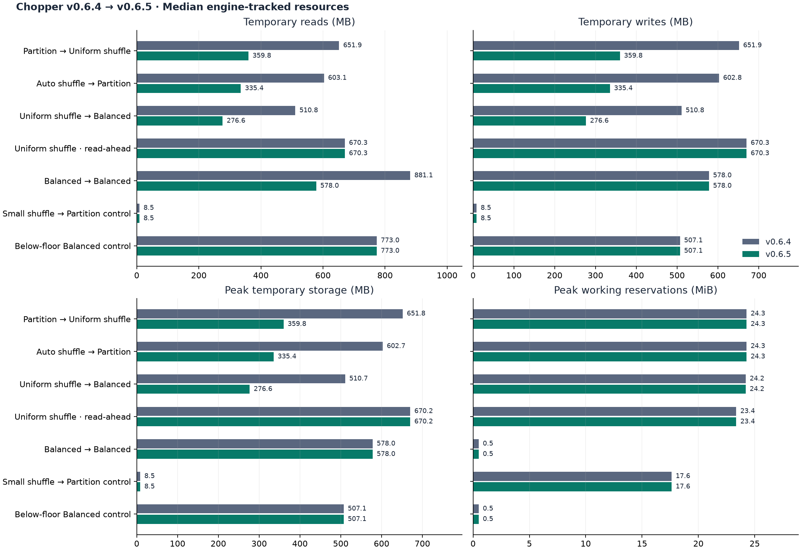

# Chopper 0.6.5

Large hosted Runs can write CSVs directly for Partition and Shuffle in either
order, or for Shuffle followed by Balanced. This release also adds read-ahead
for large standalone Uniform shuffles and shares a traversal for eligible
consecutive Balanced operations.

## Performance compared with v0.6.4

The baseline uses the published v0.6.4 hosted package. The comparison uses
the v0.6.5 hosted assets. Each workload ran with one worker in a persistent
bundled Chromium profile on WSL2, with three alternating pairs after warmup.
The timer runs from the Run request through export and worker retirement.
Every exported row and the completion marker were checked after timing.
Circles show individual observations and diamonds show medians.
[Samples, fixture settings and hashes](../benchmarks/0.6.5-performance-data.json).

| Hosted workload | Input | Median Run, v0.6.4 → v0.6.5 | Seconds saved per pair |
| --- | ---: | ---: | ---: |
| Partition → Uniform shuffle | 292.1 MB | 8.260 → 7.375 s | +0.828 to +1.001 |
| Auto shuffle → Partition | 267.4 MB | 7.560 → 6.819 s | +0.675 to +0.757 |
| Uniform shuffle → Balanced | 234.2 MB | 6.353 → 5.752 s | +0.602 to +0.644 |
| Uniform shuffle · read-ahead | 308.4 MB | 8.417 → 7.427 s | +0.933 to +1.049 |
| Balanced → Balanced | 275.0 MB | 7.014 → 6.580 s | +0.405 to +0.450 |
| Small shuffle → Partition control | 8.5 MB | 0.362 → 0.359 s | -0.001 to +0.013 |
| Below-floor Balanced control | 241.2 MB | 6.221 → 6.159 s | +0.037 to +0.073 |

The direct writer saved about 292.1 MB, 267.7 MB, and
234.2 MB of logical temporary reads on the three two-step shuffle
pipelines respectively, with comparable reductions in writes. Adjacent
Balanced avoided 303.1 MB of temporary reads and produced identical
ordered CSVs in both versions. The resource chart shows logical temporary
storage and tracked working reservations.

[Workloads and verification](../performance/investigations/hosted-release-comparison-064-to-065-2026-11-26.md) ·
[Guarded Partition then Shuffle](../performance/investigations/guarded-hosted-partition-shuffle-publication-2026-11-26.md) ·
[Shuffle then Partition](../performance/investigations/hosted-shuffle-then-partition-buffered-output-2026-11-26.md) ·
[Read-ahead and Balanced](../performance/investigations/hosted-data-movement-follow-ups-2026-11-26.md)

Saved Jobs use format version 1. Use the
[release-pinned schema](../job-json.md#editor-setup) for editor validation.
