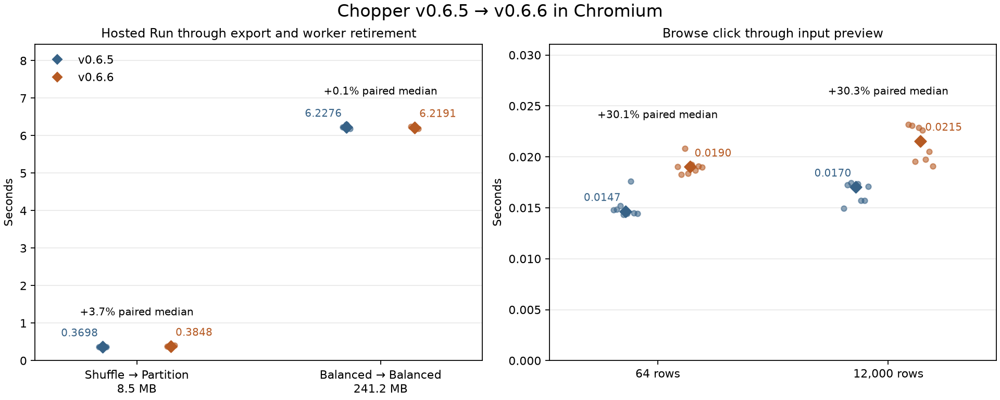
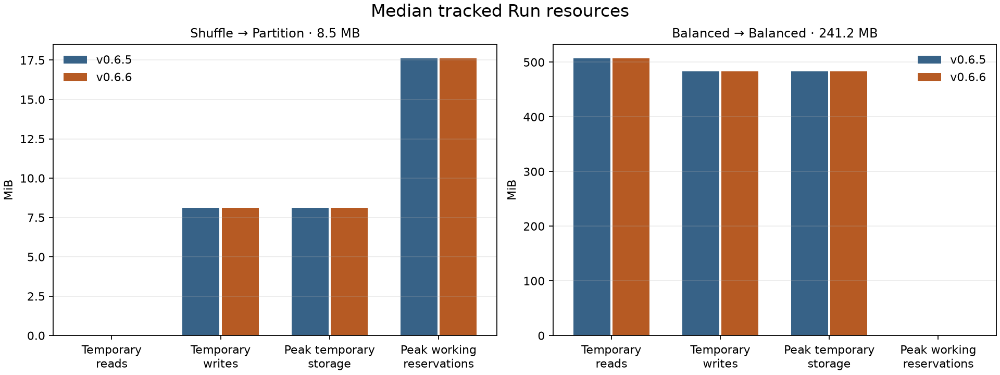

# Chopper 0.6.6

The hosted app detects CSV settings when you choose a file or ZIP member.
It applies sufficiently supported delimiter and encoding suggestions before
showing the preview. The bounded sample uses parsed record endings and
prompts for an explicit encoding when a signature is ambiguous.

Optional input settings support trimming, comment prefixes, preambles,
leading-column removal and blank data rows. Quoted fields preserve embedded
line breaks. CSV structure uses ASCII delimiters, quotes and escapes.
See [supported CSV settings](../job-json.md#csv-settings).

The compatibility suite covers 61 cases from local fixtures and selected
W3C CSVW and Go examples. It also verifies exact fields, partition membership
and duplicates in a forced spill. See the
[compatibility report](../validation.md#csv-compatibility-coverage).

Saved Jobs use format version 1. For editor validation, use the
[release-pinned schema](../job-json.md#editor-setup).

## Performance compared with v0.6.5

The local comparisons use bundled Chromium 156 on WSL2, the published v0.6.5
assets and the v0.6.6 release assets. Runs include export and worker retirement.
Preview timing starts at the Browse click after initialization and ends when
the preview rows render. The timed results exclude warmups. Each Run control
has three alternating pairs and each preview fixture has eight.

| Workload | v0.6.5 median | v0.6.6 median | Paired median change (range) |
| --- | ---: | ---: | ---: |
| Shuffle → Partition, 8.5 MB | 0.370 s | 0.385 s | +3.67% (-0.16% to +9.25%) |
| Balanced → Balanced, 241.2 MB | 6.228 s | 6.219 s | +0.08% (-1.19% to +0.29%) |
| Browse to preview, 64 rows | 0.0147 s | 0.0190 s | +30.11% (+6.11% to +37.04%) |
| Browse to preview, 12,000 rows | 0.0170 s | 0.0215 s | +30.28% (+11.82% to +54.79%) |

The preview medians increased by 4.4 and 4.5 ms, respectively. The Run
comparisons showed mixed changes within their paired ranges. Tracked resource
medians matched for both controls. The paired percentage is
`100 × (candidate − baseline) / baseline`. See the
[samples](../benchmarks/0.6.6-performance-data.json) and
[measurement scope](../performance/investigations/hosted-release-comparison-065-to-066-2026-11-27.md).
